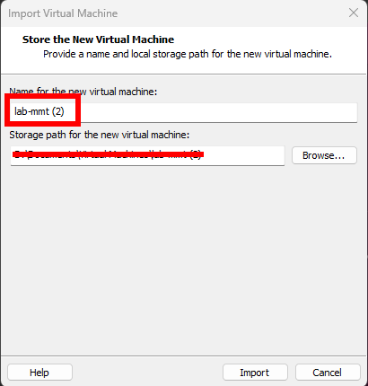

# Bài thực hành: Lập trình Socket với Java

## Mục tiêu

1. Biên dịch, chạy chương trình Java trên dòng lệnh Linux; lấy hostname, địa chỉ IP và địa chỉ MAC bằng Java.
2. Trình bày các bước của socket API (tạo socket, bind, listen, accept, connect, gửi, nhận, đóng) và lớp/hàm Java tương ứng.
3. Viết chương trình client–server dùng TCP và UDP.
4. Dùng `ss` và `tcpdump` để quan sát trạng thái kết nối và các gói tin: bắt tay 3 bước, truyền dữ liệu, đóng kết nối, gói RST, gói ICMP.
5. Dùng `nc` (netcat) và `curl` để thử nhanh một dịch vụ mạng; viết client cho một giao thức có sẵn (HTTP) và tự thiết kế một giao thức lệnh đơn giản.

## Kế hoạch buổi thực hành

| Phần | Nội dung |
|---|---|
| 0 | Chuẩn bị môi trường: hai máy ảo, mạng, Java |
| 1 | Ôn Java: biên dịch, chạy, thông tin mạng |
| 2 | Socket API từng bước (có netcat) |
| 3 | Client–server TCP và tcpdump |
| 4 | Client–server UDP và tcpdump |
| 5 | Giao thức tầng ứng dụng: HTTP và giao thức lệnh |
| 6 | Bài tập tổng hợp và mở rộng |

Bài thực hành này **không bắt buộc**: bạn làm theo tốc độ của mình và dừng ở phần nào cũng được. Các bước ghi *(Tùy chọn)* và Phần 6 dành cho ai muốn tìm hiểu thêm.

## Môi trường thực hành

Mỗi máy tính phòng lab chạy **2 máy ảo Ubuntu Desktop** trong VMware, cùng được import từ một file `lab-mmt.ova` do giảng viên cung cấp: một máy làm **server**, một máy làm **client**. Mỗi máy ảo có sẵn Java (JDK), VS Code và các công cụ mạng, nên mọi thao tác trong bài đều làm **bên trong máy ảo**, không cần Internet.

**Tài khoản** trên cả hai máy ảo là `lab`, **mật khẩu** là `1` (mật khẩu dùng khi đăng nhập và khi lệnh `sudo` hỏi mật khẩu; lúc gõ mật khẩu trong Terminal, màn hình không hiện ký tự nào).

Sơ đồ ví dụ (địa chỉ IP và tên card mạng trên máy bạn có thể khác):

```text
                     Máy tính phòng lab (VMware)
 +--------------------------------------------------------------------+
 |  +--------------------------+        +--------------------------+  |
 |  | VM server                |        | VM client                |  |
 |  | Ubuntu Desktop           |        | Ubuntu Desktop           |  |
 |  | Terminal, VS Code        |        | Terminal, VS Code        |  |
 |  | ens33: <server ip>       |        | ens33: <client ip>       |  |
 |  +-------------+------------+        +-------------+------------+  |
 |                |                                   |               |
 |  ==============+======== mạng NAT của VMware ======+=============  |
 +--------------------------------------------------------------------+
```

### Quy ước trong tài liệu

- Nhãn đứng trước mỗi khối lệnh cho biết gõ lệnh ở cửa sổ Terminal nào; mỗi nhãn là một Terminal riêng:
  - **[server-1]**, **[server-2]**: các Terminal trên VM server.
  - **[client-1]**, **[client-2]**: các Terminal trên VM client.
- Trong tài liệu, `<server ip>` là IP của VM server, `<client ip>` là IP của VM client, và card mạng là `ens33`. **Khi gõ lệnh, hãy thay `<server ip>`, `<client ip>` bằng IP thật** bạn ghi lại ở Bước 0.3 (tên card mạng trên máy bạn cũng có thể khác `ens33`). Các con số trong kết quả mẫu (cổng của client, số thứ tự, thời gian, số phiên bản…) cũng sẽ khác.
- Code dùng tiếng Việt không dấu để tránh lỗi mã hóa ký tự khi biên dịch và hiển thị.
- Mỗi phần làm trong một thư mục riêng: `~/lab/bai1`, `~/lab/bai2`, …
- Khi điền các bảng, dùng số liệu trên **chính máy của bạn** (IP, cổng, số thứ tự…); số liệu trong tài liệu chỉ là ví dụ.
- Chỉ kết nối và bắt gói trong mạng thực hành. Không gõ mật khẩu thật vào các chương trình socket trong bài: dữ liệu đi qua mạng không được mã hóa.
- Nếu Ubuntu hiện thông báo cập nhật phần mềm, bỏ qua: không cập nhật trong giờ thực hành.

---

## Phần 0. Chuẩn bị môi trường

### Bước 0.1 – Import hai máy ảo từ file OVA

**Mục đích:** có hai máy ảo độc lập trên cùng một mạng ảo, một máy làm server và một máy làm client.

**Cách làm:** import cùng một file `.ova` **hai lần**, mỗi lần với một tên và một thư mục lưu riêng. Giữ nguyên cấu hình phần cứng và card mạng như khi import. Nếu hai máy ảo của buổi trước vẫn còn trên máy tính phòng lab, dùng lại, không cần import.

**Thao tác** trong VMware:

1. Chọn **File → Open…**, chọn file `.ova` do giảng viên cung cấp.
2. Đặt tên máy ảo là `server`, chọn một thư mục lưu mới, rồi nhấn **Import**. Chờ cho tới khi import xong (vài phút).

   

3. Làm lại bước 1–2 với tên `client` và **một thư mục lưu khác**.
4. Bật cả hai máy ảo (**Power on this virtual machine**) và đăng nhập (mật khẩu `1`).

**Ghi chú:** Nếu VMware hỏi máy ảo đã được di chuyển (*moved*) hay sao chép (*copied*), chọn **I Copied It**, để mỗi máy ảo có địa chỉ MAC riêng.

### Bước 0.2 – Đặt hostname cho từng máy ảo

**Mục đích:** hai máy ảo import từ cùng một file OVA có cùng hostname. Đặt tên `server` và `client` để dấu nhắc lệnh cho biết bạn đang gõ ở máy nào.

**Cách làm:** dùng lệnh `hostnamectl set-hostname` để đổi hostname. Ubuntu còn ghi hostname ở dòng `127.0.1.1` trong file `/etc/hosts`, nên mở file đó và sửa tên ở dòng này cho khớp tên mới.

**Thao tác** trên VM server:

1. Đổi hostname:

   ```bash
   sudo hostnamectl set-hostname server
   ```

2. Mở file `/etc/hosts` bằng trình soạn thảo `nano`:

   ```bash
   sudo nano /etc/hosts
   ```

3. Tìm dòng bắt đầu bằng `127.0.1.1` (thường là dòng thứ hai). Dùng phím mũi tên đưa con trỏ tới cuối dòng, xóa tên cũ rồi gõ `server`. Dòng đó trở thành:

   ```text
   127.0.1.1	server
   ```

   Không sửa các dòng khác. Nếu file chưa có dòng `127.0.1.1`, thêm dòng trên ngay dưới dòng `127.0.0.1 localhost`.

4. Lưu bằng `Ctrl+O` rồi `Enter`, thoát bằng `Ctrl+X`.

5. Kiểm tra:

   ```bash
   hostname
   grep 127.0.1.1 /etc/hosts
   ```

Trên VM client, làm y hệt nhưng thay `server` bằng `client` ở bước 1 và bước 3.

**Kết quả** của bước 5 trên VM server:

```text
server
127.0.1.1	server
```

Đóng Terminal và mở lại: dấu nhắc lệnh đổi thành `lab@server:~$`.

### Bước 0.3 – Xem địa chỉ IP và MAC

**Mục đích:** biết IP, MAC và tên card mạng của hai máy ảo; client cần IP của server để kết nối.

**Cách làm:** dùng lệnh `ip`. Tùy chọn `-br` in gọn mỗi card một dòng, `-4` chỉ in IPv4; `ip -br link` in địa chỉ MAC.

**Lệnh** (gõ trên cả hai máy ảo):

```bash
ip -br -4 addr
ip -br link
```

**Kết quả** trên VM server:

```text
lo               UNKNOWN        127.0.0.1/8
ens33            UP             <server ip>/24
```
```text
lo               UNKNOWN        00:00:00:00:00:00 <LOOPBACK,UP,LOWER_UP>
ens33            UP             00:0c:29:3e:5a:11 <BROADCAST,MULTICAST,UP,LOWER_UP>
```

Ghi lại vào bảng sau và dùng cho cả buổi:

| | VM server | VM client |
|---|---|---|
| Tên card mạng (không phải `lo`) | | |
| Địa chỉ IPv4 | | |
| Địa chỉ MAC | | |

Hai máy ảo phải có IP khác nhau và MAC khác nhau. Nếu trùng, xem Phụ lục B.

### Bước 0.4 – Kiểm tra hai máy ảo thấy nhau

**Mục đích:** chắc chắn mạng giữa hai máy ảo hoạt động trước khi lập trình.

**Cách làm:** `ping` gửi gói ICMP *echo request* và chờ *echo reply*; `-c 3` gửi 3 gói rồi dừng.

**Lệnh** trên VM client:

```bash
ping -c 3 <server ip>
```

**Kết quả:**

```text
PING <server ip> (<server ip>) 56(84) bytes of data.
64 bytes from <server ip>: icmp_seq=1 ttl=64 time=0.512 ms
64 bytes from <server ip>: icmp_seq=2 ttl=64 time=0.431 ms
64 bytes from <server ip>: icmp_seq=3 ttl=64 time=0.455 ms

--- <server ip> ping statistics ---
3 packets transmitted, 3 received, 0% packet loss, time 2034ms
rtt min/avg/max/mdev = 0.431/0.466/0.512/0.034 ms
```

### Bước 0.5 – Kiểm tra Java, các công cụ và tạo thư mục làm việc

**Mục đích:** kiểm tra bộ công cụ Java (JDK) và các công cụ dùng trong bài, rồi tạo thư mục cho từng phần.

**Cách làm:** `java` là máy ảo Java dùng để chạy chương trình, `javac` là trình biên dịch. Chỉ có `java` mà không có `javac` nghĩa là máy mới cài JRE, chưa có JDK. `command -v` in đường dẫn của một lệnh nếu lệnh đó tồn tại. `mkdir -p` tạo thư mục (không báo lỗi nếu thư mục đã có).

**Lệnh** (gõ trên cả hai máy ảo):

```bash
java -version
javac -version
for c in code nc ss ip tcpdump curl python3; do command -v "$c" > /dev/null || echo "missing: $c"; done
mkdir -p ~/lab/bai1 ~/lab/bai2 ~/lab/bai3 ~/lab/bai4 ~/lab/bai5 ~/lab/bai6
```

Vòng `for` không in gì nghĩa là đủ công cụ. Nếu có dòng `missing: ...`, báo giảng viên; không tự tải gói qua Internet trong giờ thực hành.

**Kết quả** (số phiên bản trên máy bạn có thể khác):

```text
openjdk version "21.0.13.1" 2026-10-20
OpenJDK Runtime Environment (...)
OpenJDK 64-Bit Server VM (..., mixed mode, sharing)
javac 21.0.13.1
```

---

## Phần 1. Ôn tập Java: biên dịch, chạy, thông tin mạng

Làm trên **[server-1]**, trong thư mục `~/lab/bai1`. Câu 1.3 cần thêm số liệu của VM client: làm lại Bước 1.4 trên **[client-1]**.

### Bước 1.1 – Viết, biên dịch và chạy chương trình

**Mục đích:** nhắc lại quy trình viết → biên dịch → chạy một chương trình Java trên dòng lệnh.

**Cách làm:**
- Tên file phải trùng tên lớp `public`: lớp `Hello` nằm trong file `Hello.java`.
- `javac Hello.java` biên dịch mã nguồn thành bytecode `Hello.class`.
- `java Hello` chạy lớp `Hello` (gõ tên lớp, **không** gõ đuôi `.class`).
- `System.getProperty(...)` đọc thuộc tính hệ thống: phiên bản Java, hệ điều hành, người dùng.

**Code** `Hello.java`:

```java
public class Hello {
    public static void main(String[] args) {
        System.out.println("Xin chao, day la chuong trinh Java dau tien!");
        System.out.println("Phien ban Java : " + System.getProperty("java.version"));
        System.out.println("He dieu hanh   : " + System.getProperty("os.name")
                + " " + System.getProperty("os.version"));
        System.out.println("Nguoi dung     : " + System.getProperty("user.name"));
    }
}
```

**Lệnh:**

```bash
cd ~/lab/bai1
code Hello.java        # dán code, lưu bằng Ctrl+S
javac Hello.java
ls
java Hello
```

**Kết quả:**

```text
Hello.class  Hello.java
Xin chao, day la chuong trinh Java dau tien!
Phien ban Java : 21.0.13.1
He dieu hanh   : Linux 7.0.0-44-generic
Nguoi dung     : lab
```

> **Lỗi thường gặp**
> - `error: class Hello is public, should be declared in a file named Hello.java`: tên file khác tên lớp.
> - `Error: Could not find or load main class Hello.class`: gõ thừa `.class`. Lỗi này cũng xuất hiện khi gõ sai chữ hoa/thường (`java hello`) hoặc khi đứng sai thư mục.

### Bước 1.2 – Nhận tham số từ dòng lệnh

**Mục đích:** các chương trình mạng ở phần sau nhận IP và cổng qua tham số dòng lệnh, không phải sửa code mỗi lần đổi máy.

**Cách làm:** tham số nằm trong mảng `String[] args`, số tham số là `args.length`. `Integer.parseInt()` đổi chuỗi thành số. Biểu thức `điều_kiện ? a : b` dùng để đặt giá trị mặc định khi không có tham số.

**Code** `ThamSo.java`:

```java
public class ThamSo {
    public static void main(String[] args) {
        System.out.println("So tham so nhan duoc: " + args.length);
        for (int i = 0; i < args.length; i++) {
            System.out.println("  args[" + i + "] = " + args[i]);
        }

        // Mau dung lai o cac phan sau: tham so 1 la host, tham so 2 la port
        String host = (args.length > 0) ? args[0] : "127.0.0.1";
        int port = (args.length > 1) ? Integer.parseInt(args[1]) : 5000;
        System.out.println("=> host = " + host + ", port = " + port);
    }
}
```

**Lệnh:**

```bash
code ThamSo.java
javac ThamSo.java
java ThamSo
java ThamSo <server ip> 6000
```

**Kết quả:**

```text
So tham so nhan duoc: 0
=> host = 127.0.0.1, port = 5000
So tham so nhan duoc: 2
  args[0] = <server ip>
  args[1] = 6000
=> host = <server ip>, port = 6000
```

### Bước 1.3 – Lấy hostname và địa chỉ IP bằng `InetAddress`

**Mục đích:** làm quen với lớp biểu diễn địa chỉ IP của Java. Lớp này được dùng xuyên suốt bài.

**Cách làm:** dùng lớp `java.net.InetAddress`.

| Phương thức | Ý nghĩa |
|---|---|
| `InetAddress.getLocalHost()` | địa chỉ ứng với tên của máy hiện tại |
| `InetAddress.getLoopbackAddress()` | địa chỉ loopback (`127.0.0.1`) |
| `InetAddress.getByName("...")` | đổi một tên máy hoặc một chuỗi IP thành đối tượng `InetAddress` |
| `a.getHostName()` / `a.getHostAddress()` | tên máy / chuỗi IP của địa chỉ `a` |

Các hàm phân giải tên có thể ném `UnknownHostException`. Đây là checked exception, nên `main` phải khai báo `throws`.

**Code** `HostInfo.java`:

```java
import java.net.InetAddress;
import java.net.UnknownHostException;

public class HostInfo {
    public static void main(String[] args) throws UnknownHostException {
        // 1. Ten may va IP tuong ung voi ten may
        InetAddress local = InetAddress.getLocalHost();
        System.out.println("Hostname         : " + local.getHostName());
        System.out.println("IP theo hostname : " + local.getHostAddress());

        // 2. Dia chi loopback
        InetAddress lo = InetAddress.getLoopbackAddress();
        System.out.println("Loopback         : " + lo.getHostName() + " -> " + lo.getHostAddress());

        // 3. Phan giai cac ten/IP nhan tu tham so dong lenh
        for (String name : args) {
            InetAddress a = InetAddress.getByName(name);
            System.out.println("getByName(\"" + name + "\") -> " + a.getHostAddress());
        }
    }
}
```

**Lệnh:**

```bash
code HostInfo.java
javac HostInfo.java
java HostInfo localhost <client ip>
hostname
hostname -I
cat /etc/hosts
```

**Kết quả** của chương trình Java:

```text
Hostname         : server
IP theo hostname : 127.0.1.1
Loopback         : localhost -> 127.0.0.1
getByName("localhost") -> 127.0.0.1
getByName("<client ip>") -> <client ip>
```

**Kết quả** của ba lệnh còn lại:

```text
$ hostname
server
$ hostname -I
<server ip>
$ cat /etc/hosts
127.0.0.1 localhost
127.0.1.1	server

# The following lines are desirable for IPv6 capable hosts
::1     ip6-localhost ip6-loopback
...
```

Để ý: "IP theo hostname" là `127.0.1.1`, **không** phải IP của card mạng.

### Bước 1.4 – Liệt kê card mạng bằng `NetworkInterface`

**Mục đích:** lấy đúng IP và MAC của từng card mạng, việc mà `InetAddress.getLocalHost()` không làm được.

**Cách làm:** dùng lớp `java.net.NetworkInterface`.

| Phương thức | Ý nghĩa |
|---|---|
| `NetworkInterface.getNetworkInterfaces()` | danh sách card mạng (kiểu `Enumeration`, đổi sang `List` bằng `Collections.list`) |
| `getName()`, `isUp()`, `isLoopback()` | tên card; card có đang bật không; có phải loopback không |
| `getHardwareAddress()` | địa chỉ MAC (mảng 6 byte, `null` nếu card không có MAC) |
| `getInetAddresses()` | các địa chỉ IP gắn trên card |

`Inet4Address` và `Inet6Address` là hai lớp con của `InetAddress`, phân biệt bằng `instanceof`.

**Code** `NicInfo.java`:

```java
import java.net.Inet4Address;
import java.net.InetAddress;
import java.net.NetworkInterface;
import java.net.SocketException;
import java.util.Collections;

public class NicInfo {
    public static void main(String[] args) throws SocketException {
        for (NetworkInterface nic : Collections.list(NetworkInterface.getNetworkInterfaces())) {
            System.out.println("Card mang: " + nic.getName()
                    + (nic.isUp() ? " [UP]" : " [DOWN]")
                    + (nic.isLoopback() ? " [LOOPBACK]" : ""));

            byte[] mac = nic.getHardwareAddress();   // null neu card khong co MAC (vd: lo)
            if (mac != null) {
                System.out.println("   MAC : " + toMac(mac));
            }
            for (InetAddress a : Collections.list(nic.getInetAddresses())) {
                String type = (a instanceof Inet4Address) ? "IPv4" : "IPv6";
                System.out.println("   " + type + ": " + a.getHostAddress());
            }
        }
    }

    // Doi mang byte cua MAC thanh chuoi dang 00:0c:29:3e:5a:11
    static String toMac(byte[] mac) {
        StringBuilder sb = new StringBuilder();
        for (int i = 0; i < mac.length; i++) {
            if (i > 0) sb.append(':');
            sb.append(String.format("%02x", mac[i]));
        }
        return sb.toString();
    }
}
```

**Lệnh:**

```bash
code NicInfo.java
javac NicInfo.java
java NicInfo
ip -br addr
ip -br link
```

**Kết quả** của chương trình Java (thứ tự các dòng có thể khác):

```text
Card mang: ens33 [UP]
   MAC : 00:0c:29:3e:5a:11
   IPv6: fe80:0:0:0:9c1e:4b7a:d2f3:6a05%ens33
   IPv4: <server ip>
Card mang: lo [UP] [LOOPBACK]
   IPv6: 0:0:0:0:0:0:0:1%lo
   IPv4: 127.0.0.1
```

**Kết quả** của lệnh `ip` để đối chiếu:

```text
$ ip -br addr
lo               UNKNOWN        127.0.0.1/8 ::1/128
ens33            UP             <server ip>/24 fe80::9c1e:4b7a:d2f3:6a05/64
$ ip -br link
lo               UNKNOWN        00:00:00:00:00:00 <LOOPBACK,UP,LOWER_UP>
ens33            UP             00:0c:29:3e:5a:11 <BROADCAST,MULTICAST,UP,LOWER_UP>
```

> `fe80::…` là địa chỉ IPv6 *link-local* mà Linux tự tạo cho mỗi card. Phần sau `fe80::` có thể được suy ra từ MAC (khi đó có `ff:fe` ở giữa) hoặc được sinh ngẫu nhiên, tùy cấu hình mạng của máy. Java in IPv6 ở dạng đầy đủ (`fe80:0:0:0:…`) và thêm hậu tố `%ens33` để cho biết địa chỉ thuộc card nào.

### Bước 1.5 – (Tùy chọn) Đặt tên cho máy ảo kia trong `/etc/hosts`

**Mục đích:** thấy cách phân giải tên máy mà không cần DNS. Làm xong bước này, có thể gõ `server` thay cho IP của server.

**Cách làm:** thêm một dòng `IP   tên` vào **cuối** file `/etc/hosts`. Dùng `sudo tee -a` (`-a`: ghi thêm vào cuối file, không ghi đè). Không sửa các dòng có sẵn.

**Lệnh:**

**[client-1]**

```bash
echo "<server ip>   server" | sudo tee -a /etc/hosts
tail -n 2 /etc/hosts
ping -c 1 server
```

Làm tương tự trên **[server-1]** với dòng `<client ip>   client`, rồi `ping -c 1 client`.

### Câu hỏi và bài tập Phần 1

- **Câu 1.1.** Vì sao `HostInfo` in "IP theo hostname" là `127.0.1.1` chứ không phải IP của card `ens33`? (Gợi ý: xem `/etc/hosts`.) Muốn lấy IP thật của máy bằng Java thì dùng lớp nào?
- **Câu 1.2.** Card loopback tên gì, có những địa chỉ nào? Vì sao `NicInfo` không in MAC cho card này?
- **Câu 1.3.** Điền bảng sau cho cả hai máy ảo, dùng kết quả của `hostname` và `NicInfo`:

  | Máy ảo | Hostname | Tên card | IPv4 | MAC |
  |---|---|---|---|---|
  | server | | | | |
  | client | | | | |

- **Câu 1.4.** Vì sao hai chương trình chạy trên cùng một máy giao tiếp được với nhau qua `127.0.0.1` mà không cần Internet? Khi client và server chạy trên hai máy khác nhau, client có thể dùng `127.0.0.1` để gọi server không? (Kiểm chứng ở Bước 3.5.)
- **Bài 1.5.** Sửa `NicInfo` thành `NicInfo2`: chỉ in các card đang UP và in thêm MTU của mỗi card (phương thức `getMTU()`). MTU của `ens33` và của `lo` là bao nhiêu?
- **Bài 1.6.** Viết `Resolve.java` nhận một hoặc nhiều tên máy từ tham số, in **tất cả** địa chỉ IP của mỗi tên bằng `InetAddress.getAllByName()`. Bắt `UnknownHostException` để in thông báo khi tên không tồn tại. Chạy thử `java Resolve localhost ip6-localhost server`, rồi đối chiếu với `/etc/hosts`: mỗi địa chỉ in ra lấy từ dòng nào? Nếu đã làm Bước 1.5, chạy lại trên VM client: vì sao `server` cho kết quả khác? Thử thêm một tên không tồn tại (có thể phải chờ vài giây vì máy ảo đi hỏi DNS).

---

## Phần 2. Socket API từng bước

### 2.1 Kiến thức cần nhớ

**Socket** là một điểm cuối (endpoint) của kênh truyền giữa hai tiến trình, xác định bởi **địa chỉ IP + số cổng (port) + giao thức** (TCP hoặc UDP). Chương trình chỉ làm việc với Socket API; các tầng giao vận, mạng và liên kết dữ liệu do hệ điều hành đảm nhận:

```text
 Ứng dụng Java (client)              Ứng dụng Java (server)
        | Socket API                        | Socket API
        v                                   v
     TCP / UDP                           TCP / UDP
        |                                   |
        IP  <----------- mạng ----------->  IP
```

Mỗi kết nối TCP được xác định duy nhất bởi **bộ 5 thông số**: giao thức, IP nguồn, cổng nguồn, IP đích, cổng đích. Phía server có hai loại socket:
- **socket lắng nghe** (`ServerSocket`): chỉ có giao thức, IP cục bộ và cổng lắng nghe; chỉ dùng để nhận kết nối mới, không dùng để gửi nhận dữ liệu;
- **socket phiên** (`Socket` do `accept()` trả về): có thêm IP và cổng của client; dùng để trao đổi dữ liệu với đúng client đó.

**Cổng** là số 16 bit, từ 0 đến 65535:

| Khoảng cổng | Ý nghĩa |
|---|---|
| 0–1023 | cổng hệ thống (22: SSH, 80: HTTP, …); trên Linux phải có quyền root mới bind được |
| 1024–65535 | ứng dụng thường dùng được; bài này dùng 5000 (TCP) và 6000 (UDP) |
| 32768–60999 | khoảng cổng tạm mà Linux tự chọn cho phía client khi `connect()` |

- Bind vào cổng 0 nghĩa là nhờ hệ điều hành tự chọn một cổng còn trống.
- TCP và UDP có **không gian cổng riêng**: cổng TCP 6000 và cổng UDP 6000 là hai thứ khác nhau (kiểm chứng ở Bước 4.2).
- `0.0.0.0` là địa chỉ *wildcard* dùng khi **bind** ("mọi IP của máy này"), không phải địa chỉ đích để client kết nối tới.

**Các bước của socket API** giống nhau ở mọi ngôn ngữ (bắt nguồn từ BSD socket của C). Bảng dưới là các lớp/hàm Java tương ứng, nằm trong gói `java.net`; luồng dữ liệu nằm trong gói `java.io`.

| Bước | Hàm BSD socket (C) | Java – TCP | Java – UDP |
|---|---|---|---|
| Tạo socket | `socket()` | `new ServerSocket()` / `new Socket()` | `new DatagramSocket()` |
| Gán địa chỉ (IP, cổng) | `bind()` | `serverSocket.bind(addr)`; client có thể tự `socket.bind(addr)` | `new DatagramSocket(port)`, hoặc `new DatagramSocket(null)` rồi `bind(addr)` |
| Lắng nghe | `listen()` | làm luôn trong `bind()`; tham số *backlog* là độ dài hàng đợi kết nối, không phải số client được phục vụ cùng lúc | (không có) |
| Chấp nhận kết nối | `accept()` | `serverSocket.accept()` trả về một `Socket` | (không có) |
| Kết nối tới server | `connect()` | `socket.connect(addr, timeout)` | không bắt buộc: `connect()` |
| Gửi dữ liệu | `send()` / `write()` | `socket.getOutputStream().write(...)` | `socket.send(DatagramPacket)` |
| Nhận dữ liệu | `recv()` / `read()` | `socket.getInputStream().read(...)` | `socket.receive(DatagramPacket)` |
| Đóng | `close()` | `socket.close()` | `socket.close()` |

**Trình tự gọi hàm** của một cặp client–server TCP:

```text
  SERVER                                           CLIENT
  new ServerSocket() (socket)
  bind(5000)         (bind + listen)
  accept()           ... chờ kết nối ...           new Socket()       (socket)
                     <===== bắt tay 3 bước =====>  connect(IP, 5000)  (connect)
  accept() trả về Socket mới
  read()             <-------- dữ liệu ----------  write()
  write()            --------- dữ liệu --------->  read()
  read() trả về -1   <---------- FIN ------------  close()
  close()            ----------- FIN ----------->
```

### Bước 2.2 – Thử nhanh bằng netcat trên cùng một máy

**Mục đích:** trước khi viết Java, thấy một kết nối TCP giữa hai chương trình: một bên lắng nghe, một bên kết nối, rồi hai bên gửi văn bản cho nhau. Thí nghiệm chạy trên địa chỉ loopback `127.0.0.1` của VM server.

**Cách làm:** `nc` (netcat) là công cụ dòng lệnh đọc/ghi dữ liệu qua socket. `nc -l 127.0.0.1 5000` lắng nghe cổng 5000 trên loopback (vai server); `nc 127.0.0.1 5000` kết nối tới đó (vai client). Mỗi dòng gõ ở một bên được gửi sang bên kia; netcat chỉ chuyển dữ liệu, không tự trả lời. Bước này cần mở thêm một Terminal **[server-3]**.

**Lệnh:**

**[server-1]** (vai server):

```bash
nc -l 127.0.0.1 5000
```

**[server-2]** (vai client):

```bash
nc 127.0.0.1 5000
```

Gõ `Hello from client` ở **[server-2]** rồi Enter: dòng chữ hiện ra ở **[server-1]**. Gõ `Hello from server` ở **[server-1]**: dòng chữ hiện ra ở **[server-2]**. Trong lúc hai bên còn kết nối:

**[server-3]**

```bash
ss -ltnp | grep ':5000'
ss -tnp | grep ':5000'
```

**Kết quả:**

```text
LISTEN 0      1          127.0.0.1:5000      0.0.0.0:*    users:(("nc",pid=490,fd=3))
ESTAB 0      0          127.0.0.1:5000     127.0.0.1:46448 users:(("nc",pid=490,fd=4))
ESTAB 0      0          127.0.0.1:46448    127.0.0.1:5000  users:(("nc",pid=501,fd=4))
```

- Hai dòng `ESTAB` là **hai đầu của cùng một kết nối**, vì cả hai chương trình chạy trên một máy: đầu server có cổng 5000, đầu client có cổng 46448 do hệ điều hành chọn. Hai đầu cùng IP `127.0.0.1` và được phân biệt bằng cổng.
- Tùy chọn `-p` cho biết chương trình nào giữ socket (cột cuối).
- `nc -l` chỉ phục vụ một kết nối, không nhận thêm client nào khác. Khi một bên thoát, bên kia thường không tự thoát theo mà vẫn chờ bạn gõ tiếp: nhấn `Ctrl+C` để dừng.

Điền bảng theo kết quả trên máy bạn:

| Đầu kết nối | IP cục bộ | Cổng cục bộ | IP đầu kia | Cổng đầu kia |
|---|---|---|---|---|
| server (`nc -l`) | | | | |
| client (`nc`) | | | | |

**Quan sát gói tin trên loopback.** Nhấn `Ctrl+C` để dừng cả hai `nc`. Ở **[server-3]**, chạy:

```bash
sudo tcpdump -i lo -nn -A 'tcp port 5000'
```

Chạy lại `nc` ở **[server-1]** và **[server-2]** như trên, gửi một dòng mỗi bên, rồi dừng `nc` và dừng tcpdump bằng `Ctrl+C`. Một đoạn kết quả:

```text
08:52:02.758052 IP 127.0.0.1.46448 > 127.0.0.1.5000: Flags [S], seq 1926105106, win 65495, options [mss 65495,sackOK,TS val 1357311857 ecr 0,nop,wscale 7], length 0
08:52:02.758064 IP 127.0.0.1.5000 > 127.0.0.1.46448: Flags [S.], seq 870710189, ack 1926105107, win 65483, options [mss 65495,sackOK,TS val 2065433924 ecr 1357311857,nop,wscale 7], length 0
08:52:02.758075 IP 127.0.0.1.46448 > 127.0.0.1.5000: Flags [.], ack 1, win 512, options [nop,nop,TS val 1357311857 ecr 2065433924], length 0
...
08:52:03.748897 IP 127.0.0.1.46448 > 127.0.0.1.5000: Flags [P.], seq 1:19, ack 1, win 512, options [nop,nop,TS val 1357312848 ecr 2065433924], length 18
E..F..@.@............p..r...3........:.....
P..P{..DHello from client
```

- Địa chỉ nguồn và đích đều là `127.0.0.1`, chỉ cổng là khác nhau.
- Ba gói đầu có cờ `[S]`, `[S.]`, `[.]` là bắt tay 3 bước; sẽ phân tích kỹ ở Phần 3.
- Nội dung `Hello from client` đọc được ngay trong gói (`-A` in phần dữ liệu dạng ký tự).
- `mss 65495` rất lớn vì card `lo` có MTU 65536. Gói tin loopback **không đi qua card `ens33`**: bắt trên `-i ens33` sẽ không thấy gì.

### Bước 2.3 – Địa chỉ socket: `InetSocketAddress`

**Mục đích:** thấy "cấu trúc" của một địa chỉ socket trong Java.

**Cách làm:** lớp `java.net.InetSocketAddress` gói **IP + cổng** thành một địa chỉ socket, tương đương `struct sockaddr_in` trong C (gồm họ địa chỉ, cổng, IP). `new InetSocketAddress(port)` tạo địa chỉ *wildcard* `0.0.0.0`, nghĩa là "mọi IP của máy này". Server dùng địa chỉ này để nhận kết nối gửi tới bất kỳ IP nào của máy.

**Code** `AddrInfo.java`:

```java
import java.net.InetSocketAddress;

public class AddrInfo {
    public static void main(String[] args) {
        String host = (args.length > 0) ? args[0] : "127.0.0.1";
        int port = (args.length > 1) ? Integer.parseInt(args[1]) : 5000;

        // InetSocketAddress = dia chi IP + so port (tuong duong struct sockaddr_in trong C)
        InetSocketAddress addr = new InetSocketAddress(host, port);
        System.out.println("toString()   : " + addr);
        System.out.println("IP           : " + addr.getAddress().getHostAddress());
        System.out.println("Port         : " + addr.getPort());

        // Dia chi wildcard (0.0.0.0): server dung de lang nghe tren MOI dia chi IP cua may
        InetSocketAddress any = new InetSocketAddress(port);
        System.out.println("Wildcard     : " + any.getAddress().getHostAddress() + ":" + any.getPort());
    }
}
```

**Lệnh:**

**[server-1]**

```bash
cd ~/lab/bai2
code AddrInfo.java
javac AddrInfo.java
java AddrInfo
java AddrInfo localhost 8080
cat /proc/sys/net/ipv4/ip_local_port_range
```

**Kết quả:**

```text
toString()   : /127.0.0.1:5000
IP           : 127.0.0.1
Port         : 5000
Wildcard     : 0.0.0.0:5000
toString()   : localhost/127.0.0.1:8080
IP           : 127.0.0.1
Port         : 8080
Wildcard     : 0.0.0.0:8080
32768	60999
```

`toString()` có dạng `tên/IP:cổng`. Phần tên để trống nếu địa chỉ được tạo từ một chuỗi IP. Dòng cuối là khoảng cổng tạm của Linux.

### Bước 2.4 – Viết server theo từng bước: `BuocServer.java`

Chương trình này **dừng lại sau mỗi bước và chờ bạn nhấn Enter**, để bạn kịp quan sát ở cửa sổ **[server-2]**. Trước hết, đọc từng bước:

**(1) Tạo socket.** `ServerSocket` là socket chỉ dùng để chờ kết nối. Tạo bằng hàm khởi tạo không tham số thì socket chưa được gán địa chỉ (`isBound()` trả về `false`).

```java
ServerSocket server = new ServerSocket();
```

**(2) Bind + listen.** Gán cổng 5000 trên mọi IP của máy. Trong Java, `bind()` làm luôn việc `listen()`, với hàng đợi kết nối (*backlog*) mặc định là 50.

```java
server.bind(new InetSocketAddress(port));
```

**(3) Accept.** `accept()` chặn (block) cho tới khi có một client kết nối xong, rồi trả về một `Socket` **mới** để trao đổi với riêng client đó. `server` vẫn tiếp tục lắng nghe.

```java
Socket s = server.accept();
s.getInetAddress(); s.getPort();           // IP va cong cua client
s.getLocalAddress(); s.getLocalPort();     // IP va cong phia server
```

**(4) Nhận.** TCP truyền một *dòng byte*. `read(buf)` chặn cho tới khi có dữ liệu, rồi trả về số byte đọc được (có thể ít hơn kích thước mảng). Đổi byte thành chuỗi theo bảng mã UTF-8.

```java
InputStream in = s.getInputStream();
byte[] buf = new byte[1024];
int n = in.read(buf);
String msg = new String(buf, 0, n, StandardCharsets.UTF_8);
```

**(5) Gửi.** Đổi chuỗi thành byte rồi ghi vào luồng ra.

```java
OutputStream out = s.getOutputStream();
out.write(("Server da nhan: " + msg).getBytes(StandardCharsets.UTF_8));
out.flush();
```

**(6) Phát hiện bên kia đóng.** `read()` trả về `-1` khi client đã đóng kết nối (server đã nhận gói FIN).

```java
int m = in.read(buf);      // -1
```

**(7) Đóng.** Đóng socket kết nối và socket lắng nghe.

```java
s.close();
server.close();
```

**Code đầy đủ** `BuocServer.java`:

```java
import java.io.BufferedReader;
import java.io.IOException;
import java.io.InputStream;
import java.io.InputStreamReader;
import java.io.OutputStream;
import java.net.InetSocketAddress;
import java.net.ServerSocket;
import java.net.Socket;
import java.nio.charset.StandardCharsets;

// Server TCP viet theo tung buoc cua socket API.
// Sau moi buoc chuong trinh dung lai de quan sat bang lenh ss / tcpdump.
public class BuocServer {
    static BufferedReader keyboard = new BufferedReader(new InputStreamReader(System.in));

    static void pause(String nextStep) throws IOException {
        System.out.print(">>> Nhan Enter de sang " + nextStep + " ");
        keyboard.readLine();
    }

    public static void main(String[] args) throws IOException {
        int port = (args.length > 0) ? Integer.parseInt(args[0]) : 5000;

        // Buoc 1: tao socket (chua gan dia chi)
        ServerSocket server = new ServerSocket();
        System.out.println("[1] Da tao ServerSocket. isBound = " + server.isBound());
        pause("buoc 2 (bind + listen)");

        // Buoc 2: gan dia chi (bind) va bat dau lang nghe (listen)
        server.bind(new InetSocketAddress(port));
        System.out.println("[2] Dang lang nghe tai " + server.getInetAddress().getHostAddress()
                + ":" + server.getLocalPort());
        pause("buoc 3 (accept)");

        // Buoc 3: chap nhan ket noi (accept dung lai cho den khi co client)
        System.out.println("[3] Dang cho client ket noi...");
        Socket s = server.accept();
        System.out.println("[3] Co client ket noi!");
        System.out.println("    Dau server : " + s.getLocalAddress().getHostAddress() + ":" + s.getLocalPort());
        System.out.println("    Dau client : " + s.getInetAddress().getHostAddress() + ":" + s.getPort());
        pause("buoc 4 (nhan du lieu)");

        // Buoc 4: nhan du lieu
        InputStream in = s.getInputStream();
        byte[] buf = new byte[1024];
        int n = in.read(buf);                      // so byte doc duoc
        String msg = new String(buf, 0, n, StandardCharsets.UTF_8);
        System.out.println("[4] Nhan " + n + " byte: \"" + msg + "\"");
        pause("buoc 5 (gui phan hoi)");

        // Buoc 5: gui du lieu
        OutputStream out = s.getOutputStream();
        byte[] reply = ("Server da nhan: " + msg).getBytes(StandardCharsets.UTF_8);
        out.write(reply);
        out.flush();
        System.out.println("[5] Da gui " + reply.length + " byte");

        // Buoc 6: cho client dong ket noi -> read() tra ve -1
        System.out.println("[6] Cho client dong ket noi...");
        int m = in.read(buf);
        System.out.println("[6] read() tra ve " + m + " => client da dong ket noi");
        pause("buoc 7 (dong socket)");

        // Buoc 7: dong socket
        s.close();
        server.close();
        System.out.println("[7] Da dong socket. Ket thuc.");
    }
}
```

**Lệnh** (chỉ biên dịch, chưa chạy):

**[server-1]**

```bash
code BuocServer.java
javac BuocServer.java
```

### Bước 2.5 – Viết client theo từng bước: `BuocClient.java`

**(1) Tạo socket** chưa kết nối:

```java
Socket s = new Socket();
```

**(2) Connect** tới server, chờ tối đa 5000 ms. Hệ điều hành tự chọn cổng tạm cho client rồi thực hiện bắt tay 3 bước.

```java
s.connect(new InetSocketAddress(host, port), 5000);
```

**(3) Gửi** và **(4) nhận:** giống server, dùng `getOutputStream().write(...)` và `getInputStream().read(...)`.

**(5) Đóng:** `s.close()` gửi gói FIN cho server.

**Code đầy đủ** `BuocClient.java`:

```java
import java.io.BufferedReader;
import java.io.IOException;
import java.io.InputStream;
import java.io.InputStreamReader;
import java.io.OutputStream;
import java.net.InetSocketAddress;
import java.net.Socket;
import java.nio.charset.StandardCharsets;

// Client TCP viet theo tung buoc cua socket API.
public class BuocClient {
    static BufferedReader keyboard = new BufferedReader(new InputStreamReader(System.in));

    static void pause(String nextStep) throws IOException {
        System.out.print(">>> Nhan Enter de sang " + nextStep + " ");
        keyboard.readLine();
    }

    public static void main(String[] args) throws IOException {
        if (args.length < 1) {
            System.out.println("Cach dung: java BuocClient <IP_server> [port]");
            return;
        }
        String host = args[0];
        int port = (args.length > 1) ? Integer.parseInt(args[1]) : 5000;

        // Buoc 1: tao socket (chua ket noi)
        Socket s = new Socket();
        System.out.println("[1] Da tao Socket. isConnected = " + s.isConnected());
        pause("buoc 2 (connect)");

        // Buoc 2: ket noi toi server, cho toi da 5 giay
        s.connect(new InetSocketAddress(host, port), 5000);
        System.out.println("[2] Da ket noi!");
        System.out.println("    Dau client : " + s.getLocalAddress().getHostAddress() + ":" + s.getLocalPort());
        System.out.println("    Dau server : " + s.getInetAddress().getHostAddress() + ":" + s.getPort());
        pause("buoc 3 (gui du lieu)");

        // Buoc 3: gui du lieu
        OutputStream out = s.getOutputStream();
        byte[] data = "Xin chao server".getBytes(StandardCharsets.UTF_8);
        out.write(data);
        out.flush();
        System.out.println("[3] Da gui " + data.length + " byte");

        // Buoc 4: nhan phan hoi (read dung lai cho den khi co du lieu)
        System.out.println("[4] Cho phan hoi tu server...");
        InputStream in = s.getInputStream();
        byte[] buf = new byte[1024];
        int n = in.read(buf);
        System.out.println("[4] Nhan " + n + " byte: \"" + new String(buf, 0, n, StandardCharsets.UTF_8) + "\"");
        pause("buoc 5 (dong ket noi)");

        // Buoc 5: dong ket noi
        s.close();
        System.out.println("[5] Da dong socket. Ket thuc.");
    }
}
```

**Lệnh:**

**[client-1]**

```bash
cd ~/lab/bai2
code BuocClient.java
javac BuocClient.java
```

### Bước 2.6 – Chạy và quan sát từng bước

**Mục đích:** thấy mỗi lệnh socket làm thay đổi trạng thái của kết nối trong hệ điều hành như thế nào.

**Cách làm:** lệnh `ss` (*socket statistics*) liệt kê các socket.

| Tùy chọn của `ss` | Ý nghĩa |
|---|---|
| `-t` / `-u` | socket TCP / UDP |
| `-a` | mọi trạng thái |
| `-l` | chỉ socket đang lắng nghe |
| `-n` | in số, không đổi cổng thành tên dịch vụ |
| `'sport = :5000'` | bộ lọc: cổng phía máy mình là 5000 |
| `'dport = :5000'` | bộ lọc: cổng phía đầu kia là 5000 |

Làm lần lượt các bước **a → g** dưới đây. Mỗi lần nhấn Enter, hãy nhìn đúng cửa sổ được ghi.

**a) Tạo socket.**

**[server-1]**

```bash
java BuocServer
```

```text
[1] Da tao ServerSocket. isBound = false
>>> Nhan Enter de sang buoc 2 (bind + listen)
```

**[server-2]**

```bash
ss -tan 'sport = :5000'
```

```text
State Recv-Q Send-Q Local Address:Port Peer Address:Port Process
```

Chưa có socket nào ở cổng 5000: socket chưa bind thì chưa xuất hiện trong danh sách.

**b) Bind + listen.** Nhấn Enter ở **[server-1]**:

```text
[2] Dang lang nghe tai 0.0.0.0:5000
>>> Nhan Enter de sang buoc 3 (accept)
```

**[server-2]**

```bash
ss -tln 'sport = :5000'
```

```text
State  Recv-Q Send-Q Local Address:Port Peer Address:Port Process
LISTEN 0      50                 *:5000            *:*
```

- `LISTEN`: socket đang lắng nghe.
- Với socket LISTEN, `Send-Q` = 50 là độ dài tối đa của hàng đợi kết nối (backlog), còn `Recv-Q` là số kết nối đang chờ được `accept()`.
- `*:5000`: mọi địa chỉ IP, cổng 5000.

> Java mặc định tạo socket IPv6 kiểu *dual-stack* (phục vụ được cả IPv4). Vì vậy `ss` in `*` thay cho `0.0.0.0` và in địa chỉ IPv4 ở dạng `[::ffff:<server ip>]` (địa chỉ IPv4 ánh xạ sang IPv6). Gói tin thực sự trên mạng vẫn là IPv4, như sẽ thấy ở tcpdump.

**c) Accept và connect.** Nhấn Enter ở **[server-1]**:

```text
[3] Dang cho client ket noi...
```

**[client-1]**

```bash
java BuocClient <server ip>
```

Nhấn Enter một lần ở **[client-1]** để client connect:

```text
[1] Da tao Socket. isConnected = false
>>> Nhan Enter de sang buoc 2 (connect)
[2] Da ket noi!
    Dau client : <client ip>:43392
    Dau server : <server ip>:5000
>>> Nhan Enter de sang buoc 3 (gui du lieu)
```

**[server-1]** in thêm:

```text
[3] Co client ket noi!
    Dau server : <server ip>:5000
    Dau client : <client ip>:43392
>>> Nhan Enter de sang buoc 4 (nhan du lieu)
```

**[server-2]**

```bash
ss -tan 'sport = :5000'
```

```text
State  Recv-Q Send-Q            Local Address:Port              Peer Address:Port  Process
LISTEN 0      50                            *:5000                         *:*
ESTAB  0      0      [::ffff:<server ip>]:5000  [::ffff:<client ip>]:43392
```

Socket LISTEN vẫn còn. Có thêm một socket `ESTAB` (*established*: kết nối đã thiết lập), chính là socket mà `accept()` trả về. Cổng 43392 của client do hệ điều hành của client chọn.

**d) Client gửi.** Nhấn Enter ở **[client-1]**:

```text
[3] Da gui 15 byte
[4] Cho phan hoi tu server...
```

**[server-2]**

```bash
ss -tan 'sport = :5000'
```

```text
State  Recv-Q Send-Q            Local Address:Port              Peer Address:Port  Process
LISTEN 0      50                            *:5000                         *:*
ESTAB  15     0      [::ffff:<server ip>]:5000  [::ffff:<client ip>]:43392
```

`Recv-Q` = 15: 15 byte đã tới máy server và đang nằm trong bộ đệm nhận của hệ điều hành, chờ chương trình gọi `read()`.

**e) Server nhận rồi gửi.** Nhấn Enter ở **[server-1]** hai lần:

```text
[4] Nhan 15 byte: "Xin chao server"
>>> Nhan Enter de sang buoc 5 (gui phan hoi)
[5] Da gui 31 byte
[6] Cho client dong ket noi...
```

**[client-1]** in thêm:

```text
[4] Nhan 31 byte: "Server da nhan: Xin chao server"
>>> Nhan Enter de sang buoc 5 (dong ket noi)
```

**f) Client đóng.** Nhấn Enter ở **[client-1]**:

```text
[5] Da dong socket. Ket thuc.
```

**[server-1]** in thêm:

```text
[6] read() tra ve -1 => client da dong ket noi
>>> Nhan Enter de sang buoc 7 (dong socket)
```

**[server-2]** và **[client-1]** (client đã kết thúc nên gõ lệnh được ở cửa sổ này):

```bash
ss -tan 'sport = :5000'      # tren [server-2]
ss -tan 'dport = :5000'      # tren [client-1]
```

```text
State      Recv-Q Send-Q            Local Address:Port              Peer Address:Port  Process
LISTEN     0      50                            *:5000                         *:*
CLOSE-WAIT 0      0      [::ffff:<server ip>]:5000  [::ffff:<client ip>]:43392
```

```text
State      Recv-Q Send-Q            Local Address:Port             Peer Address:Port  Process
FIN-WAIT-2 0      0      [::ffff:<client ip>]:43392  [::ffff:<server ip>]:5000
```

Client đã gửi FIN, tức là đóng chiều client → server. Server nhận FIN nên `read()` trả về −1; socket của server ở trạng thái `CLOSE-WAIT`, chờ chương trình server đóng. Socket của client ở `FIN-WAIT-2`, chờ FIN của server.

**g) Server đóng.** Nhấn Enter ở **[server-1]**:

```text
[7] Da dong socket. Ket thuc.
```

**[client-1]**

```bash
ss -tan 'dport = :5000'
```

```text
State     Recv-Q Send-Q            Local Address:Port             Peer Address:Port  Process
TIME-WAIT 0      0      [::ffff:<client ip>]:43392  [::ffff:<server ip>]:5000
```

Phía server không còn socket nào. Phía client, bên đóng trước, giữ trạng thái `TIME-WAIT` khoảng 60 giây rồi mới xóa hẳn. Chạy lại lệnh sau một phút để kiểm tra. Socket ở `TIME-WAIT` vẫn hiện trong `ss` dù chương trình đã kết thúc; điều đó không có nghĩa là còn chương trình đang lắng nghe hay đang kết nối.

**Tóm tắt trạng thái:**

| Thời điểm | Socket phía server | Socket phía client |
|---|---|---|
| Sau `bind()` | LISTEN | (chưa có) |
| Sau `connect()` / `accept()` | ESTAB | ESTAB |
| Client `close()` | CLOSE-WAIT | FIN-WAIT-2 |
| Server `close()` | (bị xóa) | TIME-WAIT, khoảng 60 giây |

### Bước 2.7 – Các lỗi thường gặp

**a) Server chưa chạy.**

**[client-1]**

```bash
java BuocClient <server ip>
```

Nhấn Enter để connect:

```text
Exception in thread "main" java.net.ConnectException: Connection refused
	at java.base/sun.nio.ch.Net.connect0(Native Method)
	...
```

Không có chương trình nào lắng nghe cổng 5000 trên server, nên hệ điều hành của server từ chối kết nối bằng một gói RST (sẽ thấy ở Bước 3.9). Lỗi này xảy ra ở `connect()`. Hãy phân biệt nó với các lỗi xảy ra **sau khi đã kết nối**, khi đọc hoặc ghi, như `SocketTimeoutException` (Bài 2.7) hay `Connection reset`.

**b) Cổng đã bị chiếm.**

**[server-1]**

```bash
java BuocServer        # nhan Enter mot lan de bind
```

**[server-2]**

```bash
cd ~/lab/bai2
java BuocServer        # nhan Enter mot lan de bind
```

```text
Exception in thread "main" java.net.BindException: Address already in use
	at java.base/sun.nio.ch.Net.bind0(Native Method)
	...
```

Mỗi cổng TCP chỉ cho một socket lắng nghe. Để biết chương trình nào đang giữ cổng, chạy `ss -tlnp 'sport = :5000'`: cột `Process` cho biết tên và PID (ví dụ `users:(("java",pid=2422,fd=5))`). Server thứ hai đã tự thoát vì lỗi; nhấn `Ctrl+C` ở **[server-1]** để dừng server thứ nhất.

### Câu hỏi và bài tập Phần 2

- **Câu 2.1.** Ở bước b, cột `Send-Q` của dòng LISTEN là 50. Con số này là gì? Đổi bằng cách nào? (Gợi ý: `bind(SocketAddress endpoint, int backlog)`.) Đó có phải số client mà server phục vụ được cùng lúc không? Với `nc -l` ở Bước 2.2 thì con số này là bao nhiêu?
- **Câu 2.2.** Cổng của client (ví dụ 43392) do ai chọn, vào lúc nào? Chạy lại `BuocClient` vài lần: cổng có giống nhau không?
- **Câu 2.3.** Ở bước d, `Recv-Q` = 15 nói lên điều gì? Lúc đó dữ liệu đã "tới nơi" chưa?
- **Câu 2.4.** Bên nào vào trạng thái TIME-WAIT? Vì sao TCP cần trạng thái này?
- **Câu 2.5.** `read()` của server trả về −1 khi nào? Nếu chương trình không kiểm tra −1 mà gọi luôn `new String(buf, 0, n, ...)` thì chuyện gì xảy ra?
- **Bài 2.6 (hàng đợi kết nối).** Chạy `BuocServer` và **dừng ở bước 2** (đã listen, chưa accept). Cho client chạy tới bước 2 (connect). Client có kết nối được không? Xem `ss -tln 'sport = :5000'` (cột `Recv-Q`) và `ss -tan 'sport = :5000'` trên server. Giải thích vai trò của `listen()` và `accept()`.
- **Bài 2.7 (timeout).** Thêm `s.setSoTimeout(5000);` vào `BuocClient` ngay sau dòng `connect`. Chạy lại; sau khi client gửi dữ liệu (bước 3), cố tình chờ hơn 5 giây mới nhấn Enter ở server. Client báo lỗi gì? `setSoTimeout` áp dụng cho thao tác nào?
- **Bài 2.8 (TCP là dòng byte).** Sửa `BuocClient` để gửi làm hai lần: `out.write("Xin chao ".getBytes(StandardCharsets.UTF_8));` rồi `out.write("server".getBytes(StandardCharsets.UTF_8));`. Vẫn để server dừng trước bước 4 cho tới khi client gửi xong. Server nhận được bao nhiêu byte trong **một** lần `read()`? Rút ra kết luận gì về "ranh giới thông điệp" trong TCP?
- **Bài 2.9 (client tự chọn cổng nguồn).** Thêm `s.bind(new InetSocketAddress(5100));` vào `BuocClient` ngay sau dòng `Socket s = new Socket();`, biên dịch và chạy lại. Cổng phía client bây giờ là bao nhiêu? Chạy lại ngay lần nữa: nếu báo `BindException`, giải thích vì sao (gợi ý: TIME-WAIT) rồi thử cổng 5101. Sau thí nghiệm, xóa dòng `bind` đi.

---

## Phần 3. Lập trình client–server TCP và quan sát bằng tcpdump

### 3.1 Giao thức của bài

| Client gửi | Server trả lời |
|---|---|
| một dòng văn bản bất kỳ, ví dụ `hello` | `ECHO: hello` |
| `QUIT` | `BYE`, rồi đóng kết nối |

Mỗi thông điệp là **một dòng**, kết thúc bằng ký tự xuống dòng `\n`. Client và server cùng tuân theo quy ước này; một quy ước như vậy chính là **giao thức tầng ứng dụng**.

### Bước 3.2 – EchoServer (server kiểu lặp)

**Mục đích:** viết một server thật, chạy liên tục và phục vụ lần lượt từng client.

**Cách làm:**
- `new ServerSocket(port, 50, bindAddr)` tạo socket, bind và listen trong một lệnh (50 là backlog). Tham số thứ hai trên dòng lệnh là địa chỉ bind; nếu bỏ trống thì `bindAddr` là `null`, nghĩa là mọi địa chỉ của máy (`0.0.0.0`). Bước 3.5 dùng tham số này.
- Vòng `while (true)` gọi `accept()`. Phục vụ xong client này thì mới accept client tiếp theo, nên gọi là server **lặp** (*iterative*).
- Bọc luồng byte thành luồng ký tự để đọc/ghi theo dòng:
  - `new BufferedReader(new InputStreamReader(in, UTF_8))` cho phép `readLine()`. Hàm này trả về `null` khi client đóng kết nối.
  - `new PrintWriter(new OutputStreamWriter(out, UTF_8), true)` cho phép `println()`. Tham số `true` nghĩa là tự `flush` sau mỗi lần `println`, tức là gửi đi ngay.
- `try (...)` (*try-with-resources*) tự đóng socket khi ra khỏi khối lệnh, kể cả khi có lỗi.

**Code** `EchoServer.java`:

```java
import java.io.BufferedReader;
import java.io.IOException;
import java.io.InputStreamReader;
import java.io.OutputStreamWriter;
import java.io.PrintWriter;
import java.net.InetAddress;
import java.net.ServerSocket;
import java.net.Socket;
import java.nio.charset.StandardCharsets;

// TCP Echo Server kieu "lap" (iterative): phuc vu xong client nay moi accept client tiep theo.
// Giao thuc: client gui 1 dong -> server tra ve "ECHO: <dong do>". Dong "QUIT" -> server tra "BYE" roi dong.
// Cach chay: java EchoServer [port] [dia_chi_bind]   (khong ghi dia chi = moi dia chi cua may)
public class EchoServer {
    public static void main(String[] args) throws IOException {
        int port = (args.length > 0) ? Integer.parseInt(args[0]) : 5000;
        InetAddress bindAddr = (args.length > 1) ? InetAddress.getByName(args[1]) : null;

        try (ServerSocket server = new ServerSocket(port, 50, bindAddr)) {   // socket + bind + listen
            System.out.println("EchoServer dang lang nghe tai " + server.getInetAddress().getHostAddress()
                    + ":" + server.getLocalPort() + " (Ctrl+C de dung)");
            while (true) {
                try (Socket s = server.accept()) {                     // cho client
                    String client = s.getInetAddress().getHostAddress() + ":" + s.getPort();
                    System.out.println("+ Client ket noi: " + client);

                    // Boc luong byte thanh luong ky tu (UTF-8) de doc/ghi theo dong
                    BufferedReader in = new BufferedReader(
                            new InputStreamReader(s.getInputStream(), StandardCharsets.UTF_8));
                    PrintWriter out = new PrintWriter(
                            new OutputStreamWriter(s.getOutputStream(), StandardCharsets.UTF_8), true);

                    String line;
                    while ((line = in.readLine()) != null) {           // null = client da dong
                        System.out.println("  [" + client + "] " + line);
                        if (line.equalsIgnoreCase("QUIT")) {
                            out.println("BYE");
                            break;
                        }
                        out.println("ECHO: " + line);                  // println + autoFlush => gui ngay
                    }
                    System.out.println("- Client ngat ket noi: " + client);
                } catch (IOException e) {
                    System.out.println("! Loi khi phuc vu client: " + e.getMessage());
                }
            }
        }
    }
}
```

**Lệnh:**

**[server-1]**

```bash
cd ~/lab/bai3
code EchoServer.java
javac EchoServer.java
java EchoServer
```

**Kết quả:**

```text
EchoServer dang lang nghe tai 0.0.0.0:5000 (Ctrl+C de dung)
```

### Bước 3.3 – EchoClient

**Mục đích:** client gửi từng dòng gõ từ bàn phím và in ra câu trả lời của server.

**Cách làm:** `new Socket(host, port)` tạo socket và connect trong một lệnh. Bàn phím được đọc bằng `new BufferedReader(new InputStreamReader(System.in))`. Mỗi vòng lặp: `println` để gửi, rồi `readLine` để nhận.

**Code** `EchoClient.java`:

```java
import java.io.BufferedReader;
import java.io.IOException;
import java.io.InputStreamReader;
import java.io.OutputStreamWriter;
import java.io.PrintWriter;
import java.net.Socket;
import java.nio.charset.StandardCharsets;

// TCP Echo Client: doc tung dong tu ban phim, gui toi server, in ra dong tra loi.
public class EchoClient {
    public static void main(String[] args) throws IOException {
        if (args.length < 1) {
            System.out.println("Cach dung: java EchoClient <IP_server> [port]");
            return;
        }
        String host = args[0];
        int port = (args.length > 1) ? Integer.parseInt(args[1]) : 5000;

        try (Socket s = new Socket(host, port);                    // socket + connect trong 1 lenh
             BufferedReader in = new BufferedReader(
                     new InputStreamReader(s.getInputStream(), StandardCharsets.UTF_8));
             PrintWriter out = new PrintWriter(
                     new OutputStreamWriter(s.getOutputStream(), StandardCharsets.UTF_8), true);
             BufferedReader keyboard = new BufferedReader(new InputStreamReader(System.in))) {

            System.out.println("Da ket noi toi " + host + ":" + port
                    + " tu cong " + s.getLocalPort() + ". Go noi dung, QUIT de thoat.");
            while (true) {
                System.out.print("> ");
                String line = keyboard.readLine();
                if (line == null) break;                           // Ctrl+D
                out.println(line);                                 // gui 1 dong
                String reply = in.readLine();                      // nhan 1 dong
                if (reply == null) {
                    System.out.println("Server da dong ket noi.");
                    break;
                }
                System.out.println(reply);
                if (line.equalsIgnoreCase("QUIT")) break;
            }
        }
    }
}
```

**Lệnh:** gõ `hello`, rồi gõ `QUIT`.

**[client-1]**

```bash
cd ~/lab/bai3
code EchoClient.java
javac EchoClient.java
java EchoClient <server ip>
```

**Kết quả** trên **[client-1]**:

```text
Da ket noi toi <server ip>:5000 tu cong 54416. Go noi dung, QUIT de thoat.
> hello
ECHO: hello
> QUIT
BYE
```

**Kết quả** trên **[server-1]**:

```text
+ Client ket noi: <client ip>:54416
  [<client ip>:54416] hello
  [<client ip>:54416] QUIT
- Client ngat ket noi: <client ip>:54416
```

Server vẫn chạy và chờ client tiếp theo. Để nguyên server cho các bước sau.

### Bước 3.4 – Thử với netcat

**Mục đích:** thấy rằng client và server chỉ cần cùng tuân theo một quy ước về dữ liệu là nói chuyện được với nhau, dù được viết bằng ngôn ngữ nào.

**Cách làm:** dùng `nc` (viết bằng C) thay cho một trong hai chương trình Java.

**a) netcat làm client cho EchoServer.** EchoServer vẫn chạy ở **[server-1]**.

**[client-1]**

```bash
nc <server ip> 5000
```

Gõ `hello`, rồi `QUIT`. **Kết quả** (các dòng `hello`, `QUIT` là chữ bạn gõ):

```text
hello
ECHO: hello
QUIT
BYE
```

Server trả `BYE` rồi đóng kết nối. `nc` không tự thoát theo mà vẫn chờ bạn gõ tiếp: nhấn `Ctrl+C` để thoát.

**b) EchoClient nói chuyện với netcat.** Ở **[server-1]**, nhấn `Ctrl+C` để dừng EchoServer, rồi cho netcat lắng nghe cổng 5000 trên mọi địa chỉ:

```bash
nc -l 5000
```

**[client-1]**: chạy `java EchoClient <server ip>` và gõ `hello`. Dòng `hello` hiện ra ở **[server-1]**. Bây giờ **bạn** đóng vai server: gõ một câu trả lời ở **[server-1]**, ví dụ `chao ban, toi la netcat`, và câu đó hiện ra ở client. Gõ `QUIT` ở client, rồi gõ `BYE` ở **[server-1]**.

**Kết quả** trên **[client-1]**:

```text
Da ket noi toi <server ip>:5000 tu cong 44390. Go noi dung, QUIT de thoat.
> hello
chao ban, toi la netcat
> QUIT
BYE
```

EchoClient không biết đầu kia là chương trình gì. Nó chỉ cần mỗi câu trả lời là một dòng kết thúc bằng `\n`.

### Bước 3.5 – Server bind vào địa chỉ nào?

**Mục đích:** thấy địa chỉ bind quyết định ai kết nối được tới server, và gói tin loopback không đi qua card mạng.

**Cách làm:** chạy EchoServer với tham số địa chỉ bind. Bind `127.0.0.1` thì server chỉ nhận kết nối từ chính máy đó; bind `0.0.0.0` (hoặc bỏ trống) thì nhận kết nối gửi tới mọi IP của máy.

**Lệnh:**

1. **[server-1]**: nhấn `Ctrl+C` để dừng `nc` nếu còn chạy, rồi:

   ```bash
   java EchoServer 5000 127.0.0.1
   ```

2. **[server-2]**: `ss -tln 'sport = :5000'`.
3. **[server-3]**: `sudo tcpdump -i ens33 -nn tcp port 5000`.
4. **[client-1]**: lần lượt chạy `java EchoClient <server ip>` và `java EchoClient 127.0.0.1`.
5. **[server-2]**: `cd ~/lab/bai3` rồi `java EchoClient 127.0.0.1`; gõ `hello`, rồi `QUIT`.
6. **[server-1]**: nhấn `Ctrl+C`, chạy lại với `java EchoServer 5000 0.0.0.0`, rồi lặp lại các bước 2, 4 và 5.

**Kết quả** khi bind `127.0.0.1`:

```text
EchoServer dang lang nghe tai 127.0.0.1:5000 (Ctrl+C de dung)
```

```text
State  Recv-Q Send-Q          Local Address:Port Peer Address:Port Process
LISTEN 0      50     [::ffff:127.0.0.1]:5000            *:*
```

- Client trên VM client, dùng IP của server: `java.net.ConnectException: Connection refused`. tcpdump trên `ens33` thấy gói `[S]` tới và gói `[R.]` trả về: không có socket nào lắng nghe trên IP `<server ip>` ở cổng 5000.
- Client trên VM client, dùng `127.0.0.1`: cũng `Connection refused`. Trên VM client, `127.0.0.1` là **chính VM client**, nơi không có server nào.
- Client trên chính VM server, dùng `127.0.0.1`: chạy bình thường (`ECHO: hello`), nhưng tcpdump trên `ens33` **không thấy gói nào** vì kết nối đi qua card `lo`.

**Kết quả** khi bind `0.0.0.0`:

```text
EchoServer dang lang nghe tai 0.0.0.0:5000 (Ctrl+C de dung)
```

```text
State  Recv-Q Send-Q Local Address:Port Peer Address:Port Process
LISTEN 0      50                 *:5000            *:*
```

Bây giờ client trên VM client kết nối được bằng IP của server. Điền bảng (OK hay `Connection refused`):

| Server bind vào | Client trên VM client, dùng IP server | Client trên VM client, dùng `127.0.0.1` | Client trên VM server, dùng `127.0.0.1` |
|---|---|---|---|
| `127.0.0.1` | | | |
| `0.0.0.0` | | | |

Dừng server bằng `Ctrl+C`, dừng tcpdump. Từ bước sau, chạy lại EchoServer **không có tham số** (`java EchoServer`).

### Bước 3.6 – Bắt gói tin của một phiên TCP

**Mục đích:** thấy các gói tin TCP thực sự đi trên mạng giữa client và server.

**Cách làm:** `tcpdump` bắt gói tin trên một card mạng.

| Tùy chọn | Ý nghĩa |
|---|---|
| `-i ens33` | bắt trên card `ens33` (thay bằng tên card của bạn) |
| `-nn` | không đổi IP thành tên máy, không đổi cổng thành tên dịch vụ |
| `-A` / `-X` | in nội dung gói dạng ASCII / dạng hex kèm ASCII |
| `-e` | in cả header Ethernet (địa chỉ MAC) |
| `-S` | in số thứ tự (seq) tuyệt đối thay vì tương đối |
| `-v` | in chi tiết hơn (TTL, ID, checksum…) |
| `-#` | đánh số thứ tự các gói |
| `-c 10` | dừng sau 10 gói |
| `-w file.pcap` / `-r file.pcap` | ghi gói ra file / đọc lại từ file |

Bộ lọc đặt ở cuối lệnh, ví dụ: `tcp port 5000`, `udp port 6000`, `host <client ip>`, `arp`, `icmp`. Có thể ghép bằng `and`, `or`, `not`; khi ghép thì đặt cả bộ lọc trong dấu nháy đơn.

> **Luôn dùng bộ lọc.** Máy ảo Ubuntu Desktop thường xuyên gửi và nhận các gói không liên quan tới bài (phân giải tên, kiểm tra kết nối Internet, IPv6, mDNS…). Không có bộ lọc, các gói của bài sẽ lẫn trong số đó.

**Lệnh:**

1. **[server-1]**: EchoServer đang chạy (nếu đã tắt thì chạy lại).
2. **[server-2]**: bắt đầu bắt gói.

   ```bash
   sudo tcpdump -i ens33 -nn -# tcp port 5000
   ```

3. **[client-1]**: chạy `java EchoClient <server ip>`, gõ `hello`, rồi gõ `QUIT`.
4. **[server-2]**: nhấn `Ctrl+C` để dừng tcpdump.

**Kết quả** trên **[server-2]** (tùy chọn `-#` đánh số các gói ở cột trái):

```text
tcpdump: verbose output suppressed, use -v[v]... for full protocol decode
listening on ens33, link-type EN10MB (Ethernet), snapshot length 262144 bytes
    1  09:11:26.187608 IP <client ip>.54416 > <server ip>.5000: Flags [S], seq 2877318029, win 64240, options [mss 1460,sackOK,TS val 322954383 ecr 0,nop,wscale 7], length 0
    2  09:11:26.187624 IP <server ip>.5000 > <client ip>.54416: Flags [S.], seq 4141629629, ack 2877318030, win 65160, options [mss 1460,sackOK,TS val 348568750 ecr 322954383,nop,wscale 7], length 0
    3  09:11:26.187637 IP <client ip>.54416 > <server ip>.5000: Flags [.], ack 1, win 502, options [nop,nop,TS val 322954383 ecr 348568750], length 0
    4  09:11:27.123587 IP <client ip>.54416 > <server ip>.5000: Flags [P.], seq 1:7, ack 1, win 502, options [nop,nop,TS val 322955319 ecr 348568750], length 6
    5  09:11:27.123607 IP <server ip>.5000 > <client ip>.54416: Flags [.], ack 7, win 510, options [nop,nop,TS val 348569686 ecr 322955319], length 0
    6  09:11:27.128623 IP <server ip>.5000 > <client ip>.54416: Flags [P.], seq 1:13, ack 7, win 510, options [nop,nop,TS val 348569691 ecr 322955319], length 12
    7  09:11:27.128641 IP <client ip>.54416 > <server ip>.5000: Flags [.], ack 13, win 502, options [nop,nop,TS val 322955324 ecr 348569691], length 0
    8  09:11:28.124637 IP <client ip>.54416 > <server ip>.5000: Flags [P.], seq 7:12, ack 13, win 502, options [nop,nop,TS val 322956320 ecr 348569691], length 5
    9  09:11:28.125018 IP <server ip>.5000 > <client ip>.54416: Flags [P.], seq 13:17, ack 12, win 510, options [nop,nop,TS val 348570687 ecr 322956320], length 4
   10  09:11:28.125028 IP <client ip>.54416 > <server ip>.5000: Flags [.], ack 17, win 502, options [nop,nop,TS val 322956320 ecr 348570687], length 0
   11  09:11:28.126349 IP <server ip>.5000 > <client ip>.54416: Flags [F.], seq 17, ack 12, win 510, options [nop,nop,TS val 348570689 ecr 322956320], length 0
   12  09:11:28.126891 IP <client ip>.54416 > <server ip>.5000: Flags [F.], seq 12, ack 18, win 502, options [nop,nop,TS val 322956322 ecr 348570689], length 0
   13  09:11:28.126899 IP <server ip>.5000 > <client ip>.54416: Flags [.], ack 13, win 510, options [nop,nop,TS val 348570689 ecr 322956322], length 0
^C
13 packets captured
13 packets received by filter
0 packets dropped by kernel
```

**Đọc một dòng của tcpdump**, ví dụ gói số 4:

| Phần | Trong gói số 4 | Ý nghĩa |
|---|---|---|
| Thời gian | `09:11:27.123587` | giờ:phút:giây, chính xác tới micro giây |
| Nguồn > đích | `<client ip>.54416 > <server ip>.5000` | `IP.cổng` nguồn > `IP.cổng` đích |
| Cờ | `Flags [P.]` | xem bảng ngay dưới |
| Số thứ tự | `seq 1:7` | gói chở các byte thứ 1 đến 6 của chiều này |
| Báo nhận | `ack 1` | số thứ tự của byte tiếp theo mà bên gửi mong nhận |
| Cửa sổ | `win 502` | bên gửi còn nhận thêm được bao nhiêu dữ liệu |
| Tùy chọn | `options [nop,nop,TS val … ecr …]` | các tùy chọn TCP (ở đây là timestamp) |
| Độ dài | `length 6` | số byte dữ liệu, không tính header |

| tcpdump in | Cờ TCP | Ý nghĩa |
|---|---|---|
| `[S]` | SYN | xin mở kết nối |
| `[S.]` | SYN + ACK | đồng ý mở kết nối, đồng thời báo nhận |
| `[.]` | ACK | chỉ báo nhận |
| `[P.]` | PSH + ACK | có dữ liệu, đẩy ngay lên ứng dụng |
| `[F.]` | FIN + ACK | đóng chiều gửi của mình |
| `[R.]` | RST + ACK | hủy hoặc từ chối kết nối |

**Bắt tay 3 bước (gói 1–3):**
- Gói 1 `[S]`: client chọn số thứ tự ban đầu (ISN) `seq 2877318029`. Phần `options` thông báo: `mss 1460` (số byte dữ liệu tối đa trong một segment mà nó nhận được), `sackOK` (hỗ trợ báo nhận chọn lọc), `TS` (timestamp), `wscale 7` (hệ số nhân cửa sổ, 2^7).
- Gói 2 `[S.]`: server chọn ISN riêng `seq 4141629629` và báo nhận `ack 2877318030` = ISN của client + 1 (cờ SYN chiếm một số thứ tự).
- Gói 3 `[.]`: client báo nhận SYN của server; kết nối chuyển sang ESTABLISHED. Từ gói này, tcpdump in số thứ tự **tương đối** (tính từ ISN), nên thấy `ack 1`. Thêm `-S` để xem số tuyệt đối.

**Truyền dữ liệu (gói 4–10):**
- Gói 4: `seq 1:7 … length 6` là 6 byte `hello\n`, chiếm số thứ tự 1 đến 6 (số 7 là byte kế tiếp).
- Gói 5: server báo nhận `ack 7`, nghĩa là "đã nhận đủ tới byte 6, đang chờ byte 7".
- Gói 6: server trả 12 byte `ECHO: hello\n` với `seq 1:13`. Mỗi chiều truyền có dãy số thứ tự riêng.
- `win 502`: kích thước cửa sổ nhận (đã chia cho 2^7 vì `wscale 7`), cho biết bên kia còn được gửi bao nhiêu byte mà chưa cần chờ báo nhận.

**Đóng kết nối (gói 11–13):** server gửi FIN trước (ngay sau khi trả `BYE`), client gửi FIN của mình, server báo nhận. Mỗi chiều được đóng bằng một cặp FIN + ACK. Ở đây ACK của client gộp luôn vào gói FIN của nó, nên chỉ có 3 gói thay vì 4. Trên máy bạn, bên gửi FIN trước có thể khác.

```text
 client                                                         server
 <client ip>:54416                                     <server ip>:5000
    |  1  [S]  seq=ISN_c                              ---------->  |
    |  2  [S.] seq=ISN_s, ack=ISN_c+1                 <----------  |
    |  3  [.]  ack 1                                  ---------->  |  ESTABLISHED
    |  4  [P.] seq 1:7    "hello\n"                   ---------->  |
    |  5  [.]  ack 7                                  <----------  |
    |  6  [P.] seq 1:13   "ECHO: hello\n"             <----------  |
    |  7  [.]  ack 13                                 ---------->  |
    |  8  [P.] seq 7:12   "QUIT\n"                    ---------->  |
    |  9  [P.] seq 13:17  "BYE\n"                     <----------  |
    | 10  [.]  ack 17                                 ---------->  |
    | 11  [F.] seq 17                                 <----------  |  server đóng
    | 12  [F.] seq 12, ack 18                         ---------->  |  client đóng
    | 13  [.]  ack 13                                 <----------  |
```

**Lưu gói tin ra file để xem lại.** Thay vì đọc ngay trên màn hình, ghi gói tin ra file `.pcap` rồi đọc lại bao nhiêu lần cũng được.

**[server-2]** (EchoServer đang chạy ở **[server-1]**):

```bash
cd ~/lab/bai3
sudo tcpdump -i ens33 -nn -s 0 -w tcp.pcap tcp port 5000
```

**[client-1]**: chạy `java EchoClient <server ip>`, gõ một dòng bất kỳ (ví dụ `xin chao file pcap`), rồi `QUIT`. Quay lại **[server-2]**, nhấn `Ctrl+C`, rồi đọc file (đọc file không cần `sudo`):

```bash
tcpdump -nn -# -r tcp.pcap
tcpdump -nn -A -r tcp.pcap
tcpdump -nn -r tcp.pcap 'tcp[tcpflags] & tcp-syn != 0'
```

- `-w` ghi gói tin ra file, `-r` đọc lại từ file; `-s 0` lấy trọn mỗi gói tin; `-#` đánh số các gói khi đọc lại.
- Bộ lọc `'tcp[tcpflags] & tcp-syn != 0'` chỉ giữ các gói có cờ SYN, tức là gói `[S]` và `[S.]`.
- (Tùy chọn) Nếu máy ảo có cài Wireshark, mở file bằng `wireshark tcp.pcap &` để xem từng trường của mỗi gói tin (bộ lọc hiển thị: xem Phụ lục A).

Điền bảng từ file của bạn (ghi số thứ tự gói, tức cột số ở bên trái trong kết quả của `tcpdump -nn -# -r`):

| Nội dung | Kết quả |
|---|---|
| IP, cổng của client | |
| IP, cổng của server | |
| Ba gói bắt tay SYN, SYN-ACK, ACK | |
| Một gói chứa dữ liệu của client | |
| Một gói chứa trả lời của server | |
| Có gói FIN hay RST không? Ở những dòng nào? | |

> **Lưu ý**
> - Sơ đồ ở trên chỉ biểu diễn nguyên tắc. Số gói và thứ tự các gói ACK, FIN trên máy bạn có thể khác.
> - Khi chạy tcpdump với `-v`, các gói **do chính máy đó gửi đi** có thể bị báo checksum `incorrect`. Đó thường là do *checksum offload* (card mạng tính checksum sau khi tcpdump đã bắt gói), không phải lỗi mạng.

### Bước 3.7 – Xem nội dung và cấu trúc gói tin

**Mục đích:** thấy dữ liệu nằm trong gói tin, và đọc được header IP, TCP từ các byte thô.

**Cách làm:** thêm `-A` để in nội dung dạng ASCII, hoặc `-X` để in dạng hex kèm ASCII.

**Lệnh:**

**[server-2]**

```bash
sudo tcpdump -i ens33 -nn -X tcp port 5000
```

**[client-1]**: chạy lại `java EchoClient <server ip>`, gõ `hello`, rồi `QUIT`.

**Kết quả:** gói chứa `hello` trông như sau.

```text
09:11:27.123587 IP <client ip>.54416 > <server ip>.5000: Flags [P.], seq 1:7, ack 1, win 502, options [nop,nop,TS val 322955319 ecr 348568750], length 6
	0x0000:  4500 003a 19e8 4000 4006 6483 c0a8 9d81  E..:..@.@.d.....
	0x0010:  c0a8 9d80 d490 1388 ab80 638e f6dc 40be  ..........c...@.
	0x0020:  8018 01f6 78db 0000 0101 080a 133f e837  ....x........?.7
	0x0030:  14c6 bcae 6865 6c6c 6f0a                 ....hello.
```

Cột đầu là vị trí byte (hex), tiếp theo là 16 byte mỗi dòng, cột cuối là các byte đó dưới dạng ký tự (byte không in được thì hiện dấu chấm). Giải mã như sau:

| Vị trí byte | Hex | Trường | Giá trị |
|---|---|---|---|
| **Header IP** (20 byte) | | | |
| 0 | `45` | Version, IHL | IPv4; header dài 5 × 4 = 20 byte |
| 2–3 | `003a` | Total Length | 58 byte = 20 (IP) + 32 (TCP) + 6 (dữ liệu) |
| 6–7 | `4000` | Flags, Fragment Offset | cờ DF (không phân mảnh) |
| 8 | `40` | TTL | 64 |
| 9 | `06` | Protocol | 6 = TCP |
| 12–15 | `c0a8 9d81` | IP nguồn | `<client ip>`, trong ví dụ này là 192.168.157.129 (mỗi byte hex là một số của IP: `c0` = 192, `a8` = 168, `9d` = 157, `81` = 129) |
| 16–19 | `c0a8 9d80` | IP đích | `<server ip>`, trong ví dụ này là 192.168.157.128 |
| **Header TCP** (32 byte) | | | |
| 20–21 | `d490` | Cổng nguồn | 54416 |
| 22–23 | `1388` | Cổng đích | 5000 |
| 24–27 | `ab80 638e` | Sequence number | 2877318030 (= ISN client + 1) |
| 28–31 | `f6dc 40be` | Acknowledgment number | 4141629630 (= ISN server + 1) |
| 32 | `80` | Data offset | 8 × 4 = 32 byte (20 byte cố định + 12 byte options) |
| 33 | `18` | Flags | 0x18 = ACK (0x10) + PSH (0x08) |
| 34–35 | `01f6` | Window | 502 |
| 36–37 | `78db` | Checksum | |
| 40–51 | `0101 080a …` | Options | NOP, NOP, Timestamp |
| **Dữ liệu** (6 byte) | | | |
| 52–57 | `6865 6c6c 6f0a` | | `h e l l o \n` |

> Dữ liệu TCP **không được mã hóa**: ai bắt được gói tin đều đọc được `hello`. Đó là lý do các giao thức như HTTPS và SSH mã hóa dữ liệu trước khi gửi.

### Bước 3.8 – Mỗi lệnh socket sinh ra gói tin nào?

**Mục đích:** nối các bước socket API ở Phần 2 với gói tin thực tế.

**Lệnh:**

1. **[server-1]**: nhấn `Ctrl+C` để dừng EchoServer, rồi chạy:

   ```bash
   cd ~/lab/bai2
   java BuocServer
   ```

2. **[server-2]**:

   ```bash
   sudo tcpdump -i ens33 -nn tcp port 5000
   ```

3. **[client-1]**:

   ```bash
   cd ~/lab/bai2
   java BuocClient <server ip>
   ```

4. Nhấn Enter lần lượt như Bước 2.6. **Sau mỗi lần nhấn Enter, xem tcpdump in thêm những gói nào.**

**Kết quả:**

```text
09:13:07.067805 IP <client ip>.43392 > <server ip>.5000: Flags [S], seq 1326879607, win 64240, options [mss 1460,sackOK,TS val 755014966 ecr 0,nop,wscale 7], length 0
09:13:07.067818 IP <server ip>.5000 > <client ip>.43392: Flags [S.], seq 2741381473, ack 1326879608, win 65160, options [mss 1460,sackOK,TS val 443477466 ecr 755014966,nop,wscale 7], length 0
09:13:07.067829 IP <client ip>.43392 > <server ip>.5000: Flags [.], ack 1, win 502, options [nop,nop,TS val 755014966 ecr 443477466], length 0
09:13:08.070089 IP <client ip>.43392 > <server ip>.5000: Flags [P.], seq 1:16, ack 1, win 502, options [nop,nop,TS val 755015968 ecr 443477466], length 15
09:13:08.070109 IP <server ip>.5000 > <client ip>.43392: Flags [.], ack 16, win 509, options [nop,nop,TS val 443478469 ecr 755015968], length 0
09:13:10.076793 IP <server ip>.5000 > <client ip>.43392: Flags [P.], seq 1:32, ack 16, win 509, options [nop,nop,TS val 443480475 ecr 755015968], length 31
09:13:10.076858 IP <client ip>.43392 > <server ip>.5000: Flags [.], ack 32, win 502, options [nop,nop,TS val 755017975 ecr 443480475], length 0
09:13:11.077619 IP <client ip>.43392 > <server ip>.5000: Flags [F.], seq 16, ack 32, win 502, options [nop,nop,TS val 755018976 ecr 443480475], length 0
09:13:11.121123 IP <server ip>.5000 > <client ip>.43392: Flags [.], ack 17, win 509, options [nop,nop,TS val 443481520 ecr 755018976], length 0
09:13:12.113300 IP <server ip>.5000 > <client ip>.43392: Flags [F.], seq 32, ack 17, win 509, options [nop,nop,TS val 443482512 ecr 755018976], length 0
09:13:12.113326 IP <client ip>.43392 > <server ip>.5000: Flags [.], ack 33, win 502, options [nop,nop,TS val 755020012 ecr 443482512], length 0
```

| Lệnh trong chương trình | Gói tin sinh ra |
|---|---|
| server `bind()` (listen) | không có gói nào |
| client `connect()` | 3 gói bắt tay: `[S]`, `[S.]`, `[.]` |
| server `accept()` | không có gói nào: hệ điều hành đã thiết lập xong kết nối từ trước |
| client `write()` 15 byte | `[P.] length 15`; hệ điều hành của server tự báo nhận `[.] ack 16` |
| server `read()` | không có gói nào: chỉ đọc từ bộ đệm |
| server `write()` 31 byte | `[P.] length 31`; client báo nhận `[.] ack 32` |
| client `close()` | `[F.]`; server báo nhận `[.]` |
| server `close()` | `[F.]`; client báo nhận `[.]` |

Lần này việc đóng kết nối có đủ 4 gói. Server dừng chờ Enter trước bước 7, nên hai gói FIN cách nhau đúng bằng khoảng thời gian bạn chờ trước khi nhấn Enter.

### Bước 3.9 – Gói RST: kết nối tới cổng không có server

**Mục đích:** thấy hệ điều hành từ chối kết nối như thế nào.

**Lệnh:**

1. **[server-1]**: nhấn `Ctrl+C` để dừng chương trình server, nếu đang chạy.
2. **[server-2]**: chạy `sudo tcpdump -i ens33 -nn tcp port 5000`.
3. **[client-1]**: `cd ~/lab/bai3` (Bước 3.8 đã chuyển sang `~/lab/bai2`), rồi chạy `java EchoClient <server ip>`.

**Kết quả** trên **[client-1]**:

```text
Exception in thread "main" java.net.ConnectException: Connection refused
	at java.base/sun.nio.ch.Net.connect0(Native Method)
	...
```

**Kết quả** trên **[server-2]**:

```text
09:14:08.126951 IP <client ip>.57150 > <server ip>.5000: Flags [S], seq 2950675411, win 64240, options [mss 1460,sackOK,TS val 4015951009 ecr 0,nop,wscale 7], length 0
09:14:08.126968 IP <server ip>.5000 > <client ip>.57150: Flags [R.], seq 0, ack 2950675412, win 0, length 0
```

Gói SYN tới được server, nhưng không có socket nào LISTEN ở cổng 5000. Hệ điều hành của server trả về gói RST (`[R.]`), và Java phía client ném `ConnectException: Connection refused`.

### Bước 3.10 – (Tùy chọn) ARP và địa chỉ MAC

**Mục đích:** thấy rằng trước khi gửi gói IP đầu tiên, client phải hỏi địa chỉ MAC của server bằng giao thức ARP; xem header Ethernet của gói tin.

**Cách làm:** xóa bảng ARP của client bằng `ip neigh flush all` để buộc client phải hỏi lại. Thêm `-e` cho tcpdump để in địa chỉ MAC.

**Lệnh:**

1. **[server-1]**: chạy lại `java EchoServer` (trong `~/lab/bai3`).
2. **[server-2]**:

   ```bash
   sudo tcpdump -i ens33 -nn -e 'arp or tcp port 5000'
   ```

3. **[client-1]**:

   ```bash
   sudo ip neigh flush all
   java EchoClient <server ip>      # go QUIT
   ```

**Kết quả** (ba dòng đầu; có thể xen thêm các gói ARP hỏi địa chỉ gateway của mạng NAT (thường có số cuối là `.2`), hãy bỏ qua chúng):

```text
09:15:07.067790 00:0c:29:8b:c4:22 > ff:ff:ff:ff:ff:ff, ethertype ARP (0x0806), length 60: Request who-has <server ip> tell <client ip>, length 46
09:15:07.067801 00:0c:29:3e:5a:11 > 00:0c:29:8b:c4:22, ethertype ARP (0x0806), length 42: Reply <server ip> is-at 00:0c:29:3e:5a:11, length 28
09:15:07.067805 00:0c:29:8b:c4:22 > 00:0c:29:3e:5a:11, ethertype IPv4 (0x0800), length 74: <client ip>.43392 > <server ip>.5000: Flags [S], seq 1326879607, win 64240, options [mss 1460,sackOK,TS val 755014966 ecr 0,nop,wscale 7], length 0
```

- Gói ARP Request được gửi tới địa chỉ quảng bá `ff:ff:ff:ff:ff:ff` để hỏi "máy nào có IP <server ip>?". Server trả lời thẳng cho client: "IP đó ở MAC `00:0c:29:3e:5a:11`".
- Sau đó gói SYN đi trong một khung Ethernet có MAC nguồn và MAC đích. `ethertype` cho biết khung chở gì: `0x0806` là ARP, `0x0800` là IPv4.
- `length 74` là độ dài cả khung: 14 byte Ethernet + 20 byte IP + 40 byte TCP (có options).

**Kết nối tới một IP không tồn tại.** Chọn một IP cùng dải mạng mà không máy nào dùng (ví dụ lấy `<server ip>` và thay số cuối bằng 200), gọi là `<unused ip>`.

**[client-1]**

```bash
java EchoClient <unused ip>
```

Sau khoảng 3 giây:

```text
Exception in thread "main" java.net.NoRouteToHostException: No route to host
	...
```

tcpdump (vẫn chạy với bộ lọc có `arp`) thấy ba ARP Request không ai trả lời, cách nhau 1 giây, và không có gói TCP nào được gửi đi:

```text
09:16:50.238291 00:0c:29:8b:c4:22 > ff:ff:ff:ff:ff:ff, ethertype ARP (0x0806), length 60: Request who-has <unused ip> tell <client ip>, length 46
09:16:51.249194 00:0c:29:8b:c4:22 > ff:ff:ff:ff:ff:ff, ethertype ARP (0x0806), length 60: Request who-has <unused ip> tell <client ip>, length 46
09:16:52.273197 00:0c:29:8b:c4:22 > ff:ff:ff:ff:ff:ff, ethertype ARP (0x0806), length 60: Request who-has <unused ip> tell <client ip>, length 46
```

### Bước 3.11 – Hai client cùng lúc với server kiểu lặp

**Mục đích:** thấy hạn chế của server lặp và vai trò của hàng đợi kết nối.

**Lệnh:**

1. **[server-1]**: EchoServer đang chạy.
2. Trên VM client, mở thêm một Terminal, gọi là **[client-2]**.
3. **[client-1]**: chạy `java EchoClient <server ip>`, gõ `toi la A`. **Đừng gõ QUIT.**
4. **[client-2]**:

   ```bash
   cd ~/lab/bai3
   java EchoClient <server ip>
   ```

   Gõ `toi la B`: **không có trả lời**.
5. **[server-2]**: chạy `ss -tan 'sport = :5000'`.
6. **[client-1]**: gõ `QUIT`. Ngay lập tức **[client-2]** nhận được `ECHO: toi la B`.

**Kết quả** ở bước 5:

```text
State  Recv-Q Send-Q            Local Address:Port              Peer Address:Port  Process
LISTEN 1      50                            *:5000                         *:*
ESTAB  0      0      [::ffff:<server ip>]:5000  [::ffff:<client ip>]:54432
ESTAB  9      0      [::ffff:<server ip>]:5000  [::ffff:<client ip>]:54444
```

Client B đã kết nối xong, vì hệ điều hành của server đã hoàn tất bắt tay và đưa kết nối vào hàng đợi (`Recv-Q` của dòng LISTEN là 1). 9 byte `toi la B\n` cũng đã tới (`Recv-Q` = 9). Tuy vậy, chương trình server còn đang bận phục vụ A nên chưa gọi `accept()` để lấy B ra. Như vậy, **kết nối TCP thành công không có nghĩa là ứng dụng đã xử lý yêu cầu**.

### Bước 3.12 – Thử nghiệm blocking và bộ đệm

**Mục đích:** thấy `readLine()` chờ tới khi nhận được trọn một dòng, và dữ liệu nằm trong bộ đệm của chương trình chưa được gửi đi cho tới khi `flush`.

**Cách làm:** sửa EchoClient theo từng trường hợp trong bảng, mỗi lần biên dịch lại và chạy kèm `sudo tcpdump -i ens33 -nn tcp port 5000` ở **[server-2]**. Trước hết, thêm một dòng ở đầu khối `try` để client chỉ chờ trả lời tối đa 5 giây rồi báo lỗi, thay vì chờ mãi:

```java
            s.setSoTimeout(5000);                                  // cho tra loi toi da 5 giay
            System.out.println("Da ket noi toi " + host + ":" + port
```

| Trường hợp | Sửa EchoClient | Hiện tượng ở client, ở server, trên tcpdump |
|---|---|---|
| 1. Gửi bình thường | không sửa gì thêm | |
| 2. Bỏ ký tự xuống dòng | thay `out.println(line);` bằng `out.print(line);` và `out.flush();` | |
| 3. Bỏ flush | đổi tham số `true` ở cuối dòng `new PrintWriter(...)` thành `false` | |

**Kết quả mẫu** khi gõ `hello`:
- **Trường hợp 2:** tcpdump thấy gói `[P.] … length 5` (không có `\n`) tới server và được báo nhận. Server không in gì: `readLine()` còn chờ ký tự xuống dòng. Sau 5 giây, client báo `java.net.SocketTimeoutException: Read timed out` và thoát.
- **Trường hợp 3:** trong 5 giây chờ, tcpdump **không thấy gói dữ liệu nào**, vì dòng `hello` vẫn nằm trong bộ đệm của `PrintWriter`. Client cũng báo `Read timed out`. Chỉ khi chương trình kết thúc, `close()` mới đẩy dữ liệu đi, ngay trước gói FIN, nhưng lúc đó đã quá muộn.

Ở cả hai trường hợp, sau khi client đã đóng, server mới đọc được `hello` và gửi trả lời. Client không còn socket để nhận, nên trả về gói RST (`[R]`).

> **Ghi nhớ**
> - `flush()` chỉ đẩy dữ liệu từ bộ đệm của chương trình xuống hệ điều hành; nó không đảm bảo bên kia đã nhận hay đã xử lý.
> - `setSoTimeout(5000)` giới hạn **mỗi lần đọc**, không giới hạn cả phiên. `connect(addr, 5000)` chỉ giới hạn thời gian thiết lập kết nối.
> - Đóng socket thì các luồng vào/ra của nó cũng bị đóng. Nếu ghi qua bộ đệm, hãy `flush` trước khi đóng.

Làm xong, sửa EchoClient về như cũ.

### Bước 3.13 – Server đa luồng: `MultiEchoServer`

**Mục đích:** phục vụ nhiều client cùng lúc.

**Cách làm:** luồng chính chỉ làm việc `accept()`. Mỗi client được giao cho một luồng (`Thread`) riêng bằng `new Thread(() -> serve(s)).start();` (biểu thức lambda, có từ Java 8). Mỗi luồng dùng socket riêng của client mình nên các luồng không ảnh hưởng nhau.

**Code** `MultiEchoServer.java`:

```java
import java.io.BufferedReader;
import java.io.IOException;
import java.io.InputStreamReader;
import java.io.OutputStreamWriter;
import java.io.PrintWriter;
import java.net.ServerSocket;
import java.net.Socket;
import java.nio.charset.StandardCharsets;

// TCP Echo Server da luong: luong chinh chi accept, moi client duoc phuc vu boi 1 luong rieng.
public class MultiEchoServer {
    public static void main(String[] args) throws IOException {
        int port = (args.length > 0) ? Integer.parseInt(args[0]) : 5000;

        try (ServerSocket server = new ServerSocket(port)) {
            System.out.println("MultiEchoServer dang lang nghe cong " + port + " (Ctrl+C de dung)");
            while (true) {
                Socket s = server.accept();
                new Thread(() -> serve(s)).start();              // tao luong moi cho client nay
            }
        }
    }

    static void serve(Socket s) {
        String client = s.getInetAddress().getHostAddress() + ":" + s.getPort();
        String thread = Thread.currentThread().getName();
        System.out.println("+ [" + thread + "] Client ket noi: " + client);

        try (Socket sock = s;
             BufferedReader in = new BufferedReader(
                     new InputStreamReader(sock.getInputStream(), StandardCharsets.UTF_8));
             PrintWriter out = new PrintWriter(
                     new OutputStreamWriter(sock.getOutputStream(), StandardCharsets.UTF_8), true)) {

            String line;
            while ((line = in.readLine()) != null) {
                System.out.println("  [" + thread + "] " + client + ": " + line);
                if (line.equalsIgnoreCase("QUIT")) {
                    out.println("BYE");
                    break;
                }
                out.println("ECHO: " + line);
            }
        } catch (IOException e) {
            System.out.println("! [" + thread + "] Loi: " + e.getMessage());
        }
        System.out.println("- [" + thread + "] Client ngat ket noi: " + client);
    }
}
```

**Lệnh:**

**[server-1]**: nhấn `Ctrl+C` để dừng EchoServer, rồi chạy:

```bash
code MultiEchoServer.java
javac MultiEchoServer.java
java MultiEchoServer
```

Lặp lại thí nghiệm ở Bước 3.11 (A gõ `toi la A`, B gõ `toi la B`, rồi cả hai gõ `QUIT`).

**Kết quả** trên **[server-1]**: cả hai client được phục vụ ngay.

```text
MultiEchoServer dang lang nghe cong 5000 (Ctrl+C de dung)
+ [Thread-0] Client ket noi: <client ip>:58176
+ [Thread-1] Client ket noi: <client ip>:58190
  [Thread-0] <client ip>:58176: toi la A
  [Thread-1] <client ip>:58190: toi la B
  [Thread-0] <client ip>:58176: QUIT
  [Thread-1] <client ip>:58190: QUIT
- [Thread-0] Client ngat ket noi: <client ip>:58176
- [Thread-1] Client ngat ket noi: <client ip>:58190
```

Nhiều luồng chạy song song cùng dùng chung các biến `static`. Muốn đếm, chẳng hạn, tổng số thông điệp mà mọi luồng đã xử lý, hãy dùng `java.util.concurrent.atomic.AtomicInteger` và `incrementAndGet()` (Bài 3.12). Một biến `int` thường với `count++` không an toàn khi nhiều luồng cùng tăng, vì `count++` gồm ba thao tác riêng: đọc, cộng, ghi.

Trong lúc hai client đang kết nối, `ss -tan 'sport = :5000'` cho thấy hai kết nối ESTAB. Hai kết nối có cùng IP và cổng phía server (`<server ip>:5000`) và chỉ khác cổng phía client. Bộ 5 thông số khác nhau nên hệ điều hành vẫn phân biệt được hai kết nối.

### Câu hỏi và bài tập Phần 3

- **Câu 3.1.** Từ kết quả tcpdump của bạn: ISN của client và của server là bao nhiêu? Vì sao số `ack` trong gói SYN-ACK bằng ISN của client cộng 1?
- **Câu 3.2.** MSS mà hai bên thông báo là bao nhiêu? Vì sao là 1460 khi MTU của `ens33` là 1500?
- **Câu 3.3.** Gói chứa `hello` có `length 6` chứ không phải 5 – vì sao? Đọc gói chứa `QUIT` trong output `-X` của bạn: tìm IP nguồn/đích, cổng nguồn/đích, các cờ, Total Length và độ dài dữ liệu.
- **Câu 3.4.** Phiên Echo của bạn có bao nhiêu gói? Bao nhiêu gói dùng để mở và đóng kết nối? Nếu chỉ cần gửi 1 byte dữ liệu thì TCP tốn ít nhất khoảng bao nhiêu gói?
- **Câu 3.5.** Khi kết nối tới cổng không có server, server trả về gói gì? Khi kết nối tới một IP không tồn tại thì có gì khác? Trong mỗi trường hợp, Java báo ngoại lệ nào?
- **Câu 3.6.** Trong thí nghiệm hai client với EchoServer, vì sao B kết nối được nhưng không nhận được trả lời? Với MultiEchoServer thì sao?
- **Câu 3.7.** Client gọi `connect()` tới cổng 5000 của server. Vì sao các gói server gửi về lại có cổng đích khác 5000?
- **Câu 3.8.** Vì sao server không dùng `ServerSocket` để gửi dữ liệu cho client? `accept()` và `readLine()` đều làm chương trình dừng lại chờ; mỗi hàm chờ điều gì?
- **Câu 3.9.** Vì sao một lần `write()` không nhất thiết tạo ra đúng một segment TCP? (Gợi ý: Bài 2.8, Bài 6B.)
- **Câu 3.10.** Ở Bước 3.4, vì sao `nc` (viết bằng C) và chương trình Java nói chuyện được với nhau? Ở Bước 3.5, giải thích bảng kết quả bạn đã điền.
- **Bài 3.11.** Viết `PoolEchoServer`: thay `new Thread(...)` bằng một thread pool 2 luồng (`ExecutorService pool = Executors.newFixedThreadPool(2);` rồi `pool.execute(...)`). Cho 3 client kết nối cùng lúc. Client thứ 3 thế nào, khi nào nó được phục vụ? Giải thích.
- **Bài 3.12.** Sửa `MultiEchoServer` thành `MultiEchoServer2`: dùng một biến `static AtomicInteger` đếm tổng số thông điệp server đã xử lý (của mọi client), và trả lời `ECHO #<n>: ...` với `n` là giá trị bộ đếm sau khi tăng. Cho hai client gửi xen kẽ và quan sát số thứ tự.

**Tự kiểm tra Phần 3:** bạn đã điền được bảng ở Bước 3.5, Bước 3.6 (từ file `tcp.pcap`) và Bước 3.12, và trả lời được các câu hỏi trên.

---

## Phần 4. Lập trình client–server UDP

### 4.1 Kiến thức cần nhớ

- UDP **không kết nối**: không bắt tay, không đóng kết nối. Mỗi lần gửi là một gói độc lập (*datagram*) mang theo địa chỉ đích.
- UDP **giữ ranh giới thông điệp**: một lần `send()` tương ứng đúng một lần `receive()`. Nhưng UDP **không đảm bảo** gói tới nơi, không đảm bảo đúng thứ tự và không truyền lại khi mất gói.
- Trong Java: `java.net.DatagramSocket` là socket UDP; `java.net.DatagramPacket` là một datagram (mảng byte, độ dài, địa chỉ IP và cổng). Không có `listen`, `accept`, cũng không có `InputStream`/`OutputStream` (nên cũng không có `readLine()`).
- Socket UDP chỉ có giao thức, IP và cổng cục bộ; mỗi datagram nhận được có thể đến từ một đối tác khác.
- `send()` thành công chỉ có nghĩa là datagram đã được đưa xuống hệ điều hành, **không** chứng minh bên nhận đang chạy.

| Việc cần làm | Java |
|---|---|
| Tạo socket server ở cổng 6000 | `new DatagramSocket(6000)` (tạo socket + bind) |
| Tạo socket client | `new DatagramSocket()` (hệ điều hành tự chọn cổng) |
| Gửi | `socket.send(new DatagramPacket(data, data.length, ip, port))` |
| Nhận | `DatagramPacket p = new DatagramPacket(buf, buf.length); socket.receive(p);` |
| Ai gửi? | `p.getAddress()`, `p.getPort()` |
| Nhận được bao nhiêu byte? | `p.getLength()` (không phải `buf.length`) |
| Chờ có giới hạn | `socket.setSoTimeout(ms)`; quá hạn thì `receive()` ném `SocketTimeoutException` |

### Bước 4.2 – UDP từng bước: tạo, bind, nhận

**Mục đích:** đi qua các bước của socket UDP như đã làm với TCP ở Phần 2, và thấy những điểm khác: không có `listen`, `accept`, không có socket phiên.

**Cách làm:** `new DatagramSocket(null)` tạo socket UDP **chưa bind**; `bind(new InetSocketAddress(port))` gán cổng; `receive(packet)` chờ đúng một datagram. Chương trình dừng chờ Enter giữa các bước. Tham số thứ hai là kích thước bộ đệm nhận (mặc định 1024 byte).

**Code** `UdpBuoc.java`:

```java
import java.io.BufferedReader;
import java.io.IOException;
import java.io.InputStreamReader;
import java.net.DatagramPacket;
import java.net.DatagramSocket;
import java.net.InetSocketAddress;
import java.nio.charset.StandardCharsets;

// UDP theo tung buoc: tao socket chua bind -> bind -> nhan 1 datagram -> dong.
// Cach chay: java UdpBuoc [port] [kich_thuoc_bo_dem]
public class UdpBuoc {
    static BufferedReader keyboard = new BufferedReader(new InputStreamReader(System.in));

    static void pause(String nextStep) throws IOException {
        System.out.print(">>> Nhan Enter de sang " + nextStep + " ");
        keyboard.readLine();
    }

    public static void main(String[] args) throws IOException {
        int port = (args.length > 0) ? Integer.parseInt(args[0]) : 6000;
        int bufSize = (args.length > 1) ? Integer.parseInt(args[1]) : 1024;

        // Buoc 1: tao socket UDP chua bind (tham so null)
        DatagramSocket socket = new DatagramSocket(null);
        System.out.println("[1] Da tao DatagramSocket. isBound = " + socket.isBound());
        pause("buoc 2 (bind)");

        // Buoc 2: gan dia chi (moi IP cua may, cong port). UDP khong co listen/accept.
        socket.bind(new InetSocketAddress(port));
        System.out.println("[2] Da bind " + socket.getLocalAddress().getHostAddress() + ":" + socket.getLocalPort());
        pause("buoc 3 (receive)");

        // Buoc 3: cho 1 datagram
        byte[] buf = new byte[bufSize];
        DatagramPacket p = new DatagramPacket(buf, buf.length);
        System.out.println("[3] Dang cho datagram (bo dem " + bufSize + " byte)...");
        socket.receive(p);
        System.out.println("[3] Nhan tu " + p.getAddress().getHostAddress() + ":" + p.getPort());
        System.out.println("    So byte : " + p.getLength());
        System.out.println("    Noi dung: " + new String(p.getData(), 0, p.getLength(), StandardCharsets.UTF_8));

        // Buoc 4: dong socket
        socket.close();
        System.out.println("[4] Da dong socket. Ket thuc.");
    }
}
```

**Lệnh và kết quả:**

**[server-1]**

```bash
cd ~/lab/bai4
code UdpBuoc.java
javac UdpBuoc.java
java UdpBuoc
```

```text
[1] Da tao DatagramSocket. isBound = false
>>> Nhan Enter de sang buoc 2 (bind)
```

**[server-2]**: chạy `ss -uan 'sport = :6000'` trước và sau khi nhấn Enter ở **[server-1]**. Trước khi bind chỉ có dòng tiêu đề; sau khi bind:

```text
State  Recv-Q Send-Q Local Address:Port Peer Address:Port Process
UNCONN 0      0                  *:6000            *:*
```

`UNCONN`: socket UDP không có trạng thái kết nối như TCP.

**Thử thêm: TCP và UDP dùng chung số cổng.** Trong lúc `UdpBuoc` đang giữ cổng UDP 6000, chạy `nc -l 6000` (là TCP) ở **[server-3]**, rồi xem ở **[server-2]**:

```bash
ss -tuln 'sport = :6000'
```

```text
Netid State  Recv-Q Send-Q Local Address:Port Peer Address:Port Process
udp   UNCONN 0      0                  *:6000            *:*
tcp   LISTEN 0      1            0.0.0.0:6000      0.0.0.0:*
```

Không có lỗi `Address already in use`: cổng TCP 6000 và cổng UDP 6000 là hai cổng khác nhau. Nhấn `Ctrl+C` để dừng `nc`. (`ss` in `0.0.0.0` cho `nc` vì `nc` mở socket IPv4; nếu máy bạn in `[::]:6000`, `nc` đang dùng socket IPv6. Java dùng socket dual-stack nên `ss` in `*`.)

Nhấn Enter ở **[server-1]** để sang bước 3 (`receive`). Gửi một datagram từ VM client bằng netcat ở chế độ UDP (`-u`); `-w1` để `nc` thoát sau 1 giây:

**[client-1]**

```bash
printf 'hello' | nc -u -w1 <server ip> 6000
```

**Kết quả** trên **[server-1]**:

```text
[3] Dang cho datagram (bo dem 1024 byte)...
[3] Nhan tu <client ip>:45598
    So byte : 5
    Noi dung: hello
[4] Da dong socket. Ket thuc.
```

Không có `accept()`, không có socket phiên: `receive()` trả về datagram kèm địa chỉ và cổng của người gửi.

**Thử thêm: datagram lớn hơn bộ đệm.** Chạy `java UdpBuoc 6000 8` (bộ đệm 8 byte), nhấn Enter hai lần, rồi gửi 16 byte từ client:

```bash
printf 'xin chao cac ban' | nc -u -w1 <server ip> 6000
```

```text
[3] Nhan tu <client ip>:48381
    So byte : 8
    Noi dung: xin chao
```

Phần dư của datagram **bị bỏ mất**: lần `receive()` sau không đọc tiếp được phần còn lại như với TCP. Vì vậy bộ đệm nhận phải đủ lớn cho datagram dài nhất mà giao thức cho phép.

### Bước 4.3 – UdpServer

**Mục đích:** server nhận từng datagram và gửi trả lời về đúng nơi gửi.

**Cách làm:** vòng lặp `receive()`. Lấy nội dung bằng `new String(p.getData(), 0, p.getLength(), UTF_8)`, rồi gửi trả lời bằng chính địa chỉ và cổng lấy từ gói vừa nhận. Server trả lại nội dung đã đổi sang chữ IN HOA, để phân biệt với Echo của TCP.

**Code** `UdpServer.java`:

```java
import java.io.IOException;
import java.net.DatagramPacket;
import java.net.DatagramSocket;
import java.nio.charset.StandardCharsets;

// UDP Server: nhan tung datagram, tra lai noi dung da doi sang chu IN HOA cho dung nguoi gui.
public class UdpServer {
    public static void main(String[] args) throws IOException {
        int port = (args.length > 0) ? Integer.parseInt(args[0]) : 6000;

        try (DatagramSocket socket = new DatagramSocket(port)) {          // socket + bind
            System.out.println("UdpServer dang cho datagram o cong " + port + " (Ctrl+C de dung)");
            byte[] buf = new byte[1024];
            while (true) {
                // 1. Nhan 1 datagram (receive dung lai cho den khi co datagram)
                DatagramPacket request = new DatagramPacket(buf, buf.length);
                socket.receive(request);

                // Chi lay dung so byte nhan duoc: getLength(), khong phai ca mang buf
                String msg = new String(request.getData(), 0, request.getLength(), StandardCharsets.UTF_8);
                String from = request.getAddress().getHostAddress() + ":" + request.getPort();
                System.out.println("Nhan " + request.getLength() + " byte tu " + from + ": " + msg);

                // 2. Gui tra loi ve dung dia chi + port cua nguoi gui
                byte[] data = msg.toUpperCase().getBytes(StandardCharsets.UTF_8);
                DatagramPacket reply = new DatagramPacket(data, data.length,
                        request.getAddress(), request.getPort());
                socket.send(reply);
            }
        }
    }
}
```

**Lệnh:**

**[server-1]**: nhấn `Ctrl+C` để dừng server TCP nếu còn chạy, rồi:

```bash
cd ~/lab/bai4
code UdpServer.java
javac UdpServer.java
java UdpServer
```

**[server-2]**

```bash
ss -uan 'sport = :6000'
```

**Kết quả:**

```text
UdpServer dang cho datagram o cong 6000 (Ctrl+C de dung)
```

```text
State  Recv-Q Send-Q Local Address:Port Peer Address:Port Process
UNCONN 0      0                  *:6000            *:*
```

`UNCONN` (*unconnected*): socket UDP không có các trạng thái kết nối như TCP.

### Bước 4.4 – UdpClient

**Mục đích:** gửi mỗi dòng gõ từ bàn phím thành một datagram, rồi chờ trả lời tối đa 3 giây.

**Cách làm:** `new DatagramSocket()` không chỉ định cổng; `setSoTimeout(3000)` để `receive()` không chờ mãi khi gói bị mất. Bắt `SocketTimeoutException` để báo không có trả lời.

**Code** `UdpClient.java`:

```java
import java.io.BufferedReader;
import java.io.IOException;
import java.io.InputStreamReader;
import java.net.DatagramPacket;
import java.net.DatagramSocket;
import java.net.InetAddress;
import java.net.PortUnreachableException;
import java.net.SocketTimeoutException;
import java.nio.charset.StandardCharsets;

// UDP Client: moi dong go tu ban phim duoc gui thanh 1 datagram, roi cho tra loi toi da 3 giay.
public class UdpClient {
    public static void main(String[] args) throws IOException {
        if (args.length < 1) {
            System.out.println("Cach dung: java UdpClient <IP_server> [port]");
            return;
        }
        InetAddress server = InetAddress.getByName(args[0]);
        int port = (args.length > 1) ? Integer.parseInt(args[1]) : 6000;

        try (DatagramSocket socket = new DatagramSocket()) {     // khong chi dinh port -> HDH tu chon
            socket.setSoTimeout(3000);                             // receive() cho toi da 3 giay
            System.out.println("Socket UDP cua client dung cong " + socket.getLocalPort()
                    + ". Go noi dung, QUIT de thoat.");

            BufferedReader keyboard = new BufferedReader(new InputStreamReader(System.in));
            while (true) {
                System.out.print("> ");
                String line = keyboard.readLine();
                if (line == null || line.equalsIgnoreCase("QUIT")) break;

                // 1. Gui 1 datagram: du lieu + dia chi dich + port dich
                byte[] data = line.getBytes(StandardCharsets.UTF_8);
                socket.send(new DatagramPacket(data, data.length, server, port));

                // 2. Cho datagram tra loi
                byte[] buf = new byte[1024];
                DatagramPacket reply = new DatagramPacket(buf, buf.length);
                try {
                    socket.receive(reply);
                    System.out.println(new String(reply.getData(), 0, reply.getLength(), StandardCharsets.UTF_8));
                } catch (SocketTimeoutException e) {
                    System.out.println("(Khong nhan duoc tra loi sau 3 giay)");
                } catch (PortUnreachableException e) {
                    System.out.println("(Loi: PortUnreachableException - khong co chuong trinh nao o cong " + port + ")");
                }
            }
        }
    }
}
```

**Lệnh:** gõ `hello`, `xin chao`, rồi `QUIT`.

**[client-1]**

```bash
cd ~/lab/bai4
code UdpClient.java
javac UdpClient.java
java UdpClient <server ip>
```

**Kết quả** trên **[client-1]**:

```text
Socket UDP cua client dung cong 54516. Go noi dung, QUIT de thoat.
> hello
HELLO
> xin chao
XIN CHAO
> QUIT
```

**Kết quả** trên **[server-1]**:

```text
Nhan 5 byte tu <client ip>:54516: hello
Nhan 8 byte tu <client ip>:54516: xin chao
```

**Thử thêm:** netcat cũng làm được UDP client. Trên **[client-1]**, chạy `printf 'hello\n' | nc -u -w1 <server ip> 6000`: màn hình in `HELLO`, và server ghi `Nhan 6 byte` vì lần này có cả ký tự xuống dòng.

### Bước 4.5 – Bắt gói UDP

**Mục đích:** so sánh gói UDP với gói TCP ở Phần 3.

**Lệnh:**

**[server-2]**

```bash
sudo tcpdump -i ens33 -nn -X udp port 6000
```

**[client-1]**: chạy lại `java UdpClient <server ip>`, gõ `hello`, rồi `QUIT`.

**Kết quả:**

```text
09:22:42.850951 IP <client ip>.54516 > <server ip>.6000: UDP, length 5
	0x0000:  4500 0021 f75c 4000 4011 871c c0a8 9d81  E..!.\@.@.......
	0x0010:  c0a8 9d80 d4f4 1770 000d 134a 6865 6c6c  .......p...Jhell
	0x0020:  6f                                       o
09:22:42.865276 IP <server ip>.6000 > <client ip>.54516: UDP, length 5
	0x0000:  4500 0021 1594 4000 4011 68e5 c0a8 9d80  E..!..@.@.h.....
	0x0010:  c0a8 9d81 1770 d4f4 000d 738a 4845 4c4c  .....p....s.HELL
	0x0020:  4f                                       O
```

| Vị trí byte | Hex | Trường | Giá trị |
|---|---|---|---|
| 9 | `11` | Protocol (header IP) | 17 = UDP |
| **Header UDP** (8 byte) | | | |
| 20–21 | `d4f4` | Cổng nguồn | 54516 |
| 22–23 | `1770` | Cổng đích | 6000 |
| 24–25 | `000d` | Length | 13 = 8 byte header + 5 byte dữ liệu |
| 26–27 | `134a` | Checksum | |
| **Dữ liệu** | | | |
| 28–32 | `6865 6c6c 6f` | | `hello` |

Một lần hỏi–đáp chỉ có **2 gói**, không có SYN, FIN hay ACK.

**Thử thêm: lưu ra file.** Ở **[server-2]**, trong `~/lab/bai4`, chạy `sudo tcpdump -i ens33 -nn -s 0 -w udp.pcap 'udp port 6000 or icmp'`. Gửi vài thông điệp từ client, dừng tcpdump, rồi đọc lại bằng `tcpdump -nn -A -r udp.pcap`.

### Bước 4.6 – Khi server không chạy

**Mục đích:** thấy UDP báo lỗi "cổng không mở" bằng cách nào, và vì sao chương trình không biết ngay.

**Lệnh:**

1. **[server-1]**: nhấn `Ctrl+C` để dừng UdpServer.
2. **[server-2]**:

   ```bash
   sudo tcpdump -i ens33 -nn 'udp port 6000 or icmp'
   ```

3. **[client-1]**: chạy `java UdpClient <server ip>`, gõ `hello`.

**Kết quả** trên **[client-1]**, sau 3 giây:

```text
> hello
(Khong nhan duoc tra loi sau 3 giay)
```

**Kết quả** trên **[server-2]**:

```text
09:24:50.107642 IP <client ip>.49366 > <server ip>.6000: UDP, length 5
09:24:50.107661 IP <server ip> > <client ip>: ICMP <server ip> udp port 6000 unreachable, length 41
```

Hệ điều hành của server báo lỗi ngay bằng một gói **ICMP "port unreachable"** (với TCP thì là gói RST). Nhưng socket UDP chưa `connect` thì hệ điều hành của client không chuyển lỗi này cho chương trình, nên chương trình chỉ biết khi hết thời gian chờ.

> Bộ lọc phải có `or icmp`: gói ICMP không phải gói UDP nên bộ lọc `udp port 6000` không bắt được nó. Ngoài ra, không phải môi trường nào cũng trả về ICMP (tường lửa có thể chặn), nên chương trình UDP luôn phải tự xử lý việc không có trả lời.

### Bước 4.7 – `connect()` với socket UDP

**Mục đích:** thấy `connect()` của UDP chỉ ghi nhớ địa chỉ đích mà không gửi gói nào, nhưng nhờ đó chương trình nhận được báo lỗi ICMP.

**Cách làm:** thêm một dòng ngay sau khi tạo socket trong `UdpClient.java`. Từ đó socket chỉ gửi và nhận với đúng một server.

```java
        try (DatagramSocket socket = new DatagramSocket()) {     // khong chi dinh port -> HDH tu chon
            socket.connect(server, port);                          // <-- THEM DONG NAY
            socket.setSoTimeout(3000);                             // receive() cho toi da 3 giay
```

**Lệnh:** server vẫn tắt, tcpdump ở **[server-2]** vẫn chạy.

**[client-1]**

```bash
code UdpClient.java          # them dong socket.connect(server, port); roi luu
javac UdpClient.java
java UdpClient <server ip>
```

Gõ `hello`.

**Kết quả** (báo lỗi ngay, không phải chờ 3 giây):

```text
> hello
(Loi: PortUnreachableException - khong co chuong trinh nao o cong 6000)
```

Trên tcpdump: lúc chương trình gọi `connect()` không có gói nào; chỉ khi gõ `hello` mới có gói UDP và gói ICMP trả về. Chạy lại `java UdpServer` ở **[server-1]** thì client hoạt động bình thường.

### Bước 4.8 – Ứng dụng không trả lời: thông điệp `DROP`

**Mục đích:** phân biệt "server không chạy" với "server đang chạy nhưng không trả lời". Với client chưa `connect` (Bước 4.6), hai tình huống này trông giống hệt nhau: chỉ thấy hết thời gian chờ.

**Cách làm:** sửa UdpServer để bỏ qua (không trả lời) thông điệp `DROP`: thêm một dòng ngay sau dòng `System.out.println("Nhan " + ...)`:

```java
                if (msg.equals("DROP")) continue;                     // gia lap ung dung khong tra loi
```

**Lệnh:** biên dịch, chạy lại UdpServer ở **[server-1]**; ở **[client-1]** chạy `java UdpClient <server ip>`, gõ `hello`, rồi `DROP`.

**Kết quả:**

```text
> hello
HELLO
> DROP
(Khong nhan duoc tra loi sau 3 giay)
```

Server vẫn ghi `Nhan 4 byte tu ...: DROP`: datagram đã tới nơi, chỉ là ứng dụng không trả lời. Đây là mô phỏng **ứng dụng không phản hồi**, không phải bằng chứng mạng làm mất gói. Ghi lại bảng:

| Trường hợp | Client thấy gì | tcpdump trên server thấy gì |
|---|---|---|
| Server đang chạy | | |
| Server không chạy | | |
| Server nhận `DROP` | | |

Làm xong, xóa dòng `DROP` khỏi UdpServer.

### 4.9 So sánh TCP và UDP

| | TCP | UDP |
|---|---|---|
| Kết nối | có: bắt tay 3 bước, đóng bằng FIN | không |
| Độ tin cậy | báo nhận, truyền lại, đúng thứ tự | không đảm bảo |
| Ranh giới thông điệp | không có (dòng byte) | có (1 lần send = 1 lần receive) |
| Kích thước header | 20–60 byte | 8 byte |
| Khi cổng đích không mở | gói RST → `ConnectException` | gói ICMP → chờ hết giờ, hoặc `PortUnreachableException` nếu đã `connect` |
| Lớp Java | `ServerSocket`, `Socket`, `InputStream`/`OutputStream` | `DatagramSocket`, `DatagramPacket` |
| Ví dụ ứng dụng | web, SSH, email, truyền file | DNS, DHCP, game, gọi thoại/video trực tuyến |

### Bước 4.10 – (Tùy chọn) Mô phỏng mạng mất gói

**Mục đích:** thấy UDP mất dữ liệu còn TCP thì không, khi mạng bị mất gói.

**Cách làm:** lệnh `tc` với `netem` làm card mạng của server bỏ ngẫu nhiên 30% số gói gửi đi. netem chỉ ảnh hưởng tới card `ens33` của VM server; nhớ tắt khi làm xong. Nếu lệnh báo `Error: Specified qdisc kind is unknown`, máy ảo thiếu module netem: bỏ qua bước này.

**Lệnh:**

**[server-2]**

```bash
sudo tc qdisc add dev ens33 root netem loss 30%
```

Lần lượt thử:
1. **UDP:** chạy `java UdpServer` ở **[server-1]** (thư mục `~/lab/bai4`), chạy `java UdpClient <server ip>` ở **[client-1]** và gõ khoảng 10 dòng. Khoảng 30% số dòng sẽ báo `(Khong nhan duoc tra loi sau 3 giay)`.
2. **TCP:** dừng UdpServer, chạy `java EchoServer` ở **[server-1]** (thư mục `~/lab/bai3`), chạy `java EchoClient <server ip>` ở **[client-1]** (cũng trong `~/lab/bai3`) và gõ khoảng 10 dòng. Dòng nào cũng nhận được `ECHO:`, có lúc chậm hơn bình thường. Trong khi client còn kết nối, chạy `ss -ti 'sport = :5000'` ở **[server-2]** và tìm bộ đếm `retrans:` (số segment TCP đã phải truyền lại).

**Tắt netem** khi làm xong:

```bash
sudo tc qdisc del dev ens33 root
```

### Câu hỏi và bài tập Phần 4

- **Câu 4.1.** So với phiên TCP ở Phần 3, phiên UDP có gói nào để mở hoặc đóng kết nối không? Một lần hỏi–đáp tốn bao nhiêu gói với mỗi giao thức?
- **Câu 4.2.** Vì sao gói UDP chứa `hello` có `length 5`, còn gói TCP chứa `hello` ở Phần 3 có `length 6`?
- **Câu 4.3.** Header UDP dài bao nhiêu byte, gồm những trường nào? Trường Length trong header UDP của gói `hello` bằng bao nhiêu, vì sao?
- **Câu 4.4.** Khi server tắt, vì sao UdpClient (chưa `connect`) phải chờ hết 3 giây, còn sau khi thêm `connect()` thì báo lỗi ngay?
- **Câu 4.5.** Trong UdpServer, nếu viết `new String(request.getData(), StandardCharsets.UTF_8)` (bỏ `0, request.getLength()`), thì khi client gửi `xin chao` rồi gửi `hello`, server in ra gì? Vì sao? (Gợi ý: mảng `buf` được dùng lại qua các vòng lặp.)
- **Câu 4.6.** Vì sao không dùng `readLine()` để nhận datagram? Với UDP, cái gì đánh dấu chỗ kết thúc một thông điệp?
- **Câu 4.7.** Nếu bên gửi gửi một datagram dài hơn bộ đệm nhận thì chuyện gì xảy ra (xem Bước 4.2)? So sánh với TCP.
- **Câu 4.8.** `send()` của client không báo lỗi. Điều đó có chứng minh server đang chạy không? Dựa vào bảng ở Bước 4.8, client UDP có phân biệt được "server không chạy", "server không trả lời" và "mạng mất gói" không?
- **Bài 4.9 (ranh giới thông điệp).** Viết `UdpBurstClient` gửi liền ba datagram `mot`, `hai`, `ba` (không chờ trả lời), và `UdpSlowServer` bind cổng 6000, ngủ 10 giây (`Thread.sleep(10000)`) rồi mới gọi `receive()` ba lần. Mỗi lần `receive()` nhận được gì? So sánh với Bài 2.8 (TCP).
- **Bài 4.10 (UDP ping).** Viết `UdpPing` gửi 10 datagram `PING 1` … `PING 10` tới UdpServer, mỗi lần chờ trả lời tối đa 1 giây, đo thời gian khứ hồi (RTT) bằng `System.nanoTime()`, cuối cùng in số gói đã gửi, đã nhận và tỉ lệ mất gói. Chạy khi server bật, khi server tắt và (tùy chọn) khi bật netem ở Bước 4.10.

**Tự kiểm tra Phần 4:** bạn đã điền được bảng ở Bước 4.8 và trả lời được các câu hỏi trên.

---

## Phần 5. Giao thức tầng ứng dụng: HTTP và giao thức lệnh

Socket chỉ chuyển các byte; ý nghĩa của các byte đó do **giao thức tầng ứng dụng** quy định. Phần này xem một giao thức có sẵn, HTTP, ở dạng văn bản thô, rồi tự thiết kế một giao thức lệnh đơn giản. Làm trong thư mục `~/lab/bai5` trên cả hai máy.

### Bước 5.1 – Chạy một HTTP server có sẵn

**Mục đích:** có một web server thật ngay trong mạng thực hành, không cần Internet.

**Cách làm:** Python có sẵn module `http.server`. Lệnh `python3 -m http.server 8080 --bind 0.0.0.0` phục vụ các file trong thư mục hiện tại qua cổng TCP 8080. Server này chỉ dùng trong lab, không dùng làm máy chủ thật. Phía client, `curl -i` gửi một request HTTP rồi in cả phần header lẫn phần thân của response.

**Lệnh:**

**[server-1]** (dừng chương trình cũ bằng `Ctrl+C` nếu còn chạy). Tạo một thư mục chỉ chứa dữ liệu thực hành rồi chạy server trong đó:

```bash
mkdir -p ~/lab/bai5/web
cd ~/lab/bai5/web
printf '<html><body><h1>Socket Lab</h1></body></html>\n' > index.html
python3 -m http.server 8080 --bind 0.0.0.0
```

**[client-1]**

```bash
curl -i http://<server ip>:8080/
curl -i http://<server ip>:8080/not-found.html
```

**Kết quả** của lệnh `curl` thứ nhất (phiên bản Python trên máy bạn có thể khác):

```text
HTTP/1.0 200 OK
Server: SimpleHTTP/0.6 Python/3.12.3
Date: Thu, 26 Nov 2026 02:30:15 GMT
Content-type: text/html
Content-Length: 46
Last-Modified: Thu, 26 Nov 2026 02:29:40 GMT

<html><body><h1>Socket Lab</h1></body></html>
```

Lệnh thứ hai nhận `HTTP/1.0 404 File not found`, kèm một trang HTML báo lỗi. Cửa sổ server ghi lại từng request:

```text
Serving HTTP on 0.0.0.0 port 8080 (http://0.0.0.0:8080/) ...
<client ip> - - [26/Nov/2026 09:30:15] "GET / HTTP/1.1" 200 -
<client ip> - - [26/Nov/2026 09:30:15] code 404, message File not found
<client ip> - - [26/Nov/2026 09:30:15] "GET /not-found.html HTTP/1.1" 404 -
```

Ghi lại status code của mỗi request. Để server chạy cho các bước sau.

### Bước 5.2 – Gửi HTTP request bằng Java Socket

**Mục đích:** thấy HTTP chỉ là văn bản đi qua một kết nối TCP: tự viết request và đọc nguyên văn response, không dùng thư viện HTTP nào.

**Cách làm:**
- Request gồm *request line* (`GET / HTTP/1.1`), các header (`Host`, `Connection: close`), mỗi dòng kết thúc bằng `\r\n`, và một **dòng trống** (`\r\n`) đánh dấu hết phần header.
- Request được gửi theo bảng mã US-ASCII.
- `Connection: close` yêu cầu server đóng kết nối sau khi trả lời. Nhờ vậy client chỉ cần đọc bằng `InputStream` cho tới khi `read()` trả về −1.

**Code** `RawHttpClient.java`:

```java
import java.io.IOException;
import java.io.InputStream;
import java.io.OutputStream;
import java.net.InetSocketAddress;
import java.net.Socket;
import java.nio.charset.StandardCharsets;

// Gui 1 HTTP request "tho" qua socket TCP va in nguyen van response.
// Cach chay: java RawHttpClient <IP_server> [port] [duong_dan]
public class RawHttpClient {
    public static void main(String[] args) throws IOException {
        String host = args.length > 0 ? args[0] : "127.0.0.1";
        int port = args.length > 1 ? Integer.parseInt(args[1]) : 8080;
        String path = args.length > 2 ? args[2] : "/";
        try (Socket socket = new Socket()) {
            socket.connect(new InetSocketAddress(host, port), 3000);
            socket.setSoTimeout(5000);
            // Request line + header, moi dong ket thuc bang \r\n, dong trong (\r\n) bao het header
            String request = "GET " + path + " HTTP/1.1\r\n"
                    + "Host: " + host + ":" + port + "\r\n"
                    + "Connection: close\r\n"
                    + "\r\n";
            OutputStream out = socket.getOutputStream();
            out.write(request.getBytes(StandardCharsets.US_ASCII));
            out.flush();
            // Doc cho toi khi server dong ket noi (read tra ve -1)
            InputStream in = socket.getInputStream();
            byte[] buffer = new byte[4096];
            int n;
            while ((n = in.read(buffer)) != -1) {
                System.out.write(buffer, 0, n);
            }
            System.out.flush();
        }
    }
}
```

**Lệnh:**

**[client-1]**

```bash
cd ~/lab/bai5
code RawHttpClient.java
javac RawHttpClient.java
java RawHttpClient <server ip> 8080 /
java RawHttpClient <server ip> 8080 /not-found.html
```

**Kết quả** của lệnh thứ nhất giống hệt output của `curl -i`, vì chương trình in nguyên văn các byte server gửi về:

```text
HTTP/1.0 200 OK
Server: SimpleHTTP/0.6 Python/3.12.3
Date: Thu, 26 Nov 2026 02:30:16 GMT
Content-type: text/html
Content-Length: 46
Last-Modified: Thu, 26 Nov 2026 02:29:40 GMT

<html><body><h1>Socket Lab</h1></body></html>
```

Chương trình này chỉ dành cho các response nhỏ của server trong lab. Nó không xử lý chunked encoding, TLS, keep-alive hay file nhị phân, nên không phải một trình duyệt.

**Thử thêm:** netcat cũng gửi được một HTTP request "bằng tay":

```bash
printf 'GET / HTTP/1.0\r\n\r\n' | nc <server ip> 8080
```

### Bước 5.3 – Phân tích HTTP bằng tcpdump

**Mục đích:** tìm request và response HTTP bên trong các segment TCP.

**Lệnh:**

**[server-2]**

```bash
cd ~/lab/bai5
sudo tcpdump -i ens33 -nn -s 0 -w http.pcap tcp port 8080
```

**[client-1]**: chạy lại `java RawHttpClient <server ip> 8080 /`. Dừng tcpdump bằng `Ctrl+C`, rồi đọc file:

```bash
tcpdump -nn -A -r http.pcap
```

**Kết quả** (đã bỏ các dòng ký tự rác của header IP/TCP, chỉ giữ các gói có dữ liệu và các gói FIN):

```text
09:30:16.843228 IP <client ip>.49622 > <server ip>.8080: Flags [P.], seq 1:66, ack 1, win 502, options [...], length 65
GET / HTTP/1.1
Host: <server ip>:8080
Connection: close

09:30:16.844813 IP <server ip>.8080 > <client ip>.49622: Flags [P.], seq 1:186, ack 66, win 509, options [...], length 185
HTTP/1.0 200 OK
Server: SimpleHTTP/0.6 Python/3.12.3
Date: Thu, 26 Nov 2026 02:30:16 GMT
Content-type: text/html
Content-Length: 46
Last-Modified: Thu, 26 Nov 2026 02:29:40 GMT

09:30:16.844870 IP <server ip>.8080 > <client ip>.49622: Flags [P.], seq 186:232, ack 66, win 509, options [...], length 46
<html><body><h1>Socket Lab</h1></body></html>
09:30:16.844909 IP <server ip>.8080 > <client ip>.49622: Flags [F.], seq 232, ack 66, win 509, options [...], length 0
09:30:16.845473 IP <client ip>.49622 > <server ip>.8080: Flags [F.], seq 66, ack 233, win 501, options [...], length 0
```

- Request 65 byte nằm trọn trong một segment.
- Response đi thành hai segment: phần header 185 byte và phần thân 46 byte (bằng đúng `Content-Length`).
- Server gửi FIN trước, vì request có `Connection: close`.

Điền bảng theo dữ liệu trong file của bạn:

| Thành phần | Giá trị |
|---|---|
| Request line | |
| Header `Host` | |
| Dấu hiệu kết thúc phần header | |
| Status line | |
| `Content-Type` | |
| `Content-Length` | |
| Nội dung phần thân | |

**Thử thêm: bỏ dòng trống cuối request.** Trong `RawHttpClient.java`, xóa dòng `+ "\r\n";` cuối cùng, rồi thêm dấu `;` vào cuối dòng `Connection` để câu lệnh kết thúc ở đó: `+ "Connection: close\r\n";`. Biên dịch, chạy lại. Server chưa trả lời vì còn chờ hết phần header; sau 5 giây client báo `java.net.SocketTimeoutException: Read timed out`. Khi client đóng kết nối, Python mới coi như đã hết phần header, xử lý request và gửi response, nhưng client không còn nhận nữa, nên log của server có thể kèm lỗi `BrokenPipeError`. Khôi phục code sau khi thử.

### Bước 5.4 – Giao thức lệnh: đặc tả

Bây giờ tự thiết kế một giao thức trên TCP. Quy ước:
- Mỗi thông điệp là **một dòng** UTF-8 kết thúc bằng `\n`. Tên lệnh không phân biệt chữ hoa/thường.
- Ngay khi client kết nối, server gửi một **dòng chào** `OK READY ...`. Client phải đọc dòng này trước khi gửi lệnh.
- Mỗi lệnh nhận đúng **một dòng trả lời**, bắt đầu bằng `OK` (thành công) hoặc `ERR` (lỗi). Lỗi cú pháp không làm kết thúc phiên.
- `ADD` nhận hai số nguyên 32 bit, kết quả tính bằng `long` để không bị tràn số. `UPPER` nhận toàn bộ phần văn bản sau tên lệnh.

| Yêu cầu | Trả lời |
|---|---|
| `TIME` | `OK` và thời gian của server |
| `UPPER hello world` | `OK HELLO WORLD` |
| `ADD 12 8` | `OK 20` |
| `ADD x 2` | `ERR INVALID NUMBER` |
| `ADD 1` | `ERR USAGE: ADD <a> <b>` |
| `UPPER` | `ERR MISSING TEXT` |
| `POW 2 3` | `ERR UNKNOWN COMMAND` |
| dòng trống | `ERR EMPTY COMMAND` |
| `QUIT` | `OK BYE`, rồi đóng phiên |

### Bước 5.5 – CommandServer và CommandClient

**Mục đích:** cài đặt giao thức ở Bước 5.4, tách phần "hiểu lệnh" ra khỏi phần mạng.

**Cách làm:**
- Server giữ cấu trúc của EchoServer: vòng `accept()` bên ngoài, vòng `readLine()` bên trong.
- Mọi xử lý lệnh nằm trong hàm `handle(String line)`. Hàm này nhận một dòng và trả về đúng một dòng trả lời; muốn thêm lệnh mới, chỉ cần sửa hàm này.
- `line.split("\\s+", 2)` tách tên lệnh và phần còn lại. `switch` chọn lệnh theo tên đã đổi sang chữ hoa. `Integer.parseInt` ném `NumberFormatException` khi gặp số sai.
- Client đọc dòng chào trước, rồi mỗi lệnh gửi một dòng và đọc một dòng.

**Code** `CommandServer.java`:

```java
import java.io.BufferedReader;
import java.io.IOException;
import java.io.InputStreamReader;
import java.io.OutputStreamWriter;
import java.io.PrintWriter;
import java.net.ServerSocket;
import java.net.Socket;
import java.nio.charset.StandardCharsets;
import java.time.LocalDateTime;
import java.time.format.DateTimeFormatter;
import java.util.Locale;

// Giao thuc lenh tren TCP: moi dong la 1 lenh, moi lenh nhan dung 1 dong tra loi "OK ..." hoac "ERR ...".
// Server phuc vu lan luot tung client (kieu lap). Cach chay: java CommandServer [port]
public class CommandServer {
    static final DateTimeFormatter FMT = DateTimeFormatter.ofPattern("yyyy-MM-dd HH:mm:ss");

    public static void main(String[] args) throws IOException {
        int port = (args.length > 0) ? Integer.parseInt(args[0]) : 5000;
        try (ServerSocket server = new ServerSocket(port)) {
            System.out.println("CommandServer dang lang nghe cong " + port + " (Ctrl+C de dung)");
            while (true) {
                try (Socket s = server.accept()) {
                    serve(s);
                } catch (IOException e) {
                    System.out.println("! Loi client: " + e.getMessage());
                }
            }
        }
    }

    static void serve(Socket s) throws IOException {
        String client = s.getInetAddress().getHostAddress() + ":" + s.getPort();
        System.out.println("+ Client ket noi: " + client);
        BufferedReader in = new BufferedReader(new InputStreamReader(s.getInputStream(), StandardCharsets.UTF_8));
        PrintWriter out = new PrintWriter(new OutputStreamWriter(s.getOutputStream(), StandardCharsets.UTF_8), true);

        out.println("OK READY (TIME | UPPER <text> | ADD <a> <b> | QUIT)");     // dong chao
        String line;
        while ((line = in.readLine()) != null) {
            String reply = handle(line.trim());
            System.out.println("  [" + client + "] " + line + "  ->  " + reply);
            out.println(reply);
            if (reply.equals("OK BYE")) break;
        }
        System.out.println("- Client ngat ket noi: " + client);
    }

    // Xu ly 1 lenh, tra ve dung 1 dong phan hoi. Loi cu phap khong lam ket thuc phien.
    static String handle(String line) {
        if (line.isEmpty()) return "ERR EMPTY COMMAND";
        String[] parts = line.split("\\s+", 2);                  // ten lenh + phan con lai
        switch (parts[0].toUpperCase(Locale.ROOT)) {
            case "TIME":
                return (parts.length == 1) ? "OK " + LocalDateTime.now().format(FMT) : "ERR USAGE: TIME";
            case "UPPER":
                return (parts.length == 2) ? "OK " + parts[1].toUpperCase(Locale.ROOT) : "ERR MISSING TEXT";
            case "ADD": {
                String[] nums = line.split("\\s+");
                if (nums.length != 3) return "ERR USAGE: ADD <a> <b>";
                try {
                    long sum = (long) Integer.parseInt(nums[1]) + Integer.parseInt(nums[2]);
                    return "OK " + sum;
                } catch (NumberFormatException e) {
                    return "ERR INVALID NUMBER";
                }
            }
            case "QUIT":
                return (parts.length == 1) ? "OK BYE" : "ERR USAGE: QUIT";
            default:
                return "ERR UNKNOWN COMMAND";
        }
    }
}
```

**Code** `CommandClient.java`:

```java
import java.io.BufferedReader;
import java.io.IOException;
import java.io.InputStreamReader;
import java.io.OutputStreamWriter;
import java.io.PrintWriter;
import java.net.Socket;
import java.nio.charset.StandardCharsets;

// Client cho giao thuc lenh: doc dong chao TRUOC, sau do moi lenh go vao nhan dung 1 dong tra loi.
// Cach chay: java CommandClient <IP_server> [port]
public class CommandClient {
    public static void main(String[] args) throws IOException {
        if (args.length < 1) {
            System.out.println("Cach dung: java CommandClient <IP_server> [port]");
            return;
        }
        String host = args[0];
        int port = (args.length > 1) ? Integer.parseInt(args[1]) : 5000;

        try (Socket s = new Socket(host, port);
             BufferedReader in = new BufferedReader(
                     new InputStreamReader(s.getInputStream(), StandardCharsets.UTF_8));
             PrintWriter out = new PrintWriter(
                     new OutputStreamWriter(s.getOutputStream(), StandardCharsets.UTF_8), true);
             BufferedReader keyboard = new BufferedReader(new InputStreamReader(System.in))) {

            s.setSoTimeout(5000);                                  // moi lan doc cho toi da 5 giay
            System.out.println("Server: " + in.readLine());        // dong chao
            while (true) {
                System.out.print("> ");
                String line = keyboard.readLine();
                if (line == null) break;
                out.println(line);
                String reply = in.readLine();
                if (reply == null) {
                    System.out.println("Server da dong ket noi.");
                    break;
                }
                System.out.println("Server: " + reply);
                if (reply.equals("OK BYE")) break;
            }
        }
    }
}
```

**Lệnh:**

**[server-1]**: nhấn `Ctrl+C` để dừng Python server, rồi:

```bash
cd ~/lab/bai5
code CommandServer.java
javac CommandServer.java
java CommandServer
```

**[client-1]**

```bash
cd ~/lab/bai5
code CommandClient.java
javac CommandClient.java
java CommandClient <server ip>
```

Thử lần lượt các lệnh trong bảng ở Bước 5.4, thêm `TIME extra`, `ADD 2147483647 1`, `QUIT extra`, `add 1 2`, và một lệnh đúng ngay sau một lệnh sai.

**Kết quả:**

```text
Server: OK READY (TIME | UPPER <text> | ADD <a> <b> | QUIT)
> TIME
Server: OK 2026-11-26 09:35:12
> UPPER hello world
Server: OK HELLO WORLD
> ADD 12 8
Server: OK 20
> ADD x 2
Server: ERR INVALID NUMBER
> ADD 1
Server: ERR USAGE: ADD <a> <b>
> UPPER
Server: ERR MISSING TEXT
> POW 2 3
Server: ERR UNKNOWN COMMAND
>
Server: ERR EMPTY COMMAND
> TIME extra
Server: ERR USAGE: TIME
> ADD 2147483647 1
Server: OK 2147483648
> QUIT extra
Server: ERR USAGE: QUIT
> add 1 2
Server: OK 3
> QUIT
Server: OK BYE
```

Cửa sổ server ghi từng lệnh và câu trả lời, ví dụ `[<client ip>:38198] ADD 12 8  ->  OK 20`.

**Thử thêm:**
- **Kiểm tra server bằng netcat:** `nc <server ip> 5000`. Dòng chào hiện ra ngay; gõ `ADD 3 4` nhận `OK 7`.
- **Client không đọc dòng chào:** dùng EchoClient của Phần 3 (`cd ~/lab/bai3 && java EchoClient <server ip>`) để gửi `ADD 1 2`, rồi `UPPER abc`, rồi `QUIT`:

  ```text
  > ADD 1 2
  OK READY (TIME | UPPER <text> | ADD <a> <b> | QUIT)
  > UPPER abc
  OK 3
  > QUIT
  OK ABC
  ```

  Mỗi câu trả lời bị **lệch một nhịp**: EchoClient lấy dòng chào làm câu trả lời cho `ADD 1 2`, lấy `OK 3` làm câu trả lời cho `UPPER abc`, và thoát trước khi nhận `OK BYE`.

### Câu hỏi và bài tập Phần 5

- **Câu 5.1.** Request gửi `HTTP/1.1` nhưng server Python trả lời bằng phiên bản nào? Server có nhất thiết phải trả lời đúng phiên bản trong request không?
- **Câu 5.2.** curl, chương trình Java và netcat đều lấy được trang web. HTTP có phụ thuộc vào ngôn ngữ lập trình phía client không? Điều gì làm cho chúng nói chuyện được với server?
- **Câu 5.3.** Gọi server bằng IP như trong bài thì có cần truy vấn DNS không? Nếu thay IP bằng một tên máy, việc phân giải tên xảy ra ở đâu, trước hay sau `connect()`?
- **Câu 5.4.** Client biết phần thân của response dài bao nhiêu nhờ đâu? Vì sao header và phần thân lại nằm ở hai segment khác nhau, và điều đó có ảnh hưởng gì tới RawHttpClient không?
- **Câu 5.5.** Vì sao phải quy định rõ định dạng request/response? Ở thí nghiệm EchoClient với CommandServer, các câu trả lời bị lệch như thế nào và vì sao?
- **Câu 5.6.** So sánh giao thức lệnh tự thiết kế với HTTP: dòng chào, mã kết quả (`OK`/`ERR` so với status code), cách đánh dấu hết một thông điệp, ai đóng kết nối.
- **Bài 5.7.** Bổ sung `SUB`, `MUL`, `DIV` vào CommandServer (tạo `CommandServer2`). Hai toán hạng là số nguyên 32 bit; `SUB`/`MUL` trả kết quả `long`, `DIV` trả `double` và trả `ERR DIV_ZERO` khi chia cho 0. Ví dụ `SUB 2 7` → `OK -5`, `MUL -3 4` → `OK -12`, `DIV 7 2` → `OK 3.5`. Kiểm tra sai số lượng tham số, số sai, khoảng trắng thừa, lệnh không tồn tại. Server phải chạy tiếp sau mỗi lỗi, và sau `QUIT` vẫn nhận được client mới.
- **Bài 5.8.** CommandServer phục vụ lần lượt từng client, giống EchoServer. Viết `MultiCommandServer` theo cách làm của MultiEchoServer (Bước 3.13): mỗi client được phục vụ bởi một luồng riêng. Nếu đặt file cùng thư mục với `CommandServer.java`, có thể gọi lại `CommandServer.serve(s)` thay vì chép lại code. Mở hai CommandClient cùng lúc ở **[client-1]** và **[client-2]**, so sánh với CommandServer: client thứ hai nhận dòng chào lúc nào?

**Tự kiểm tra Phần 5:** RawHttpClient in được response; bạn đã điền được bảng ở Bước 5.3 (từ file `http.pcap`); CommandServer trả lời đúng mọi trường hợp ở Bước 5.4; và trả lời được các câu hỏi trên.

---

## Phần 6. Bài tập tổng hợp và mở rộng (chọn một hoặc hai)

Làm trong thư mục `~/lab/bai6`. Một bài coi là xong khi chương trình chạy được giữa hai máy ảo: server trên VM server, client trên VM client.

### Bài 6A – Chat hai chiều qua TCP

**Yêu cầu:**
- Một chương trình `Chat.java` chạy được cả hai vai trò:
  - `java Chat server [port]` trên VM server;
  - `java Chat client <IP_server> [port]` trên VM client.
- Sau khi kết nối, hai bên gõ tin nhắn tự do. Tin nhắn của bên kia hiện ra ngay khi tới, không phải chờ mình gõ xong.
- Gõ `/quit` để thoát; bên còn lại được báo "Ben kia da thoat" rồi cũng kết thúc.

**Gợi ý:**
- Mỗi bên cần **hai luồng**: luồng chính đọc bàn phím rồi `println` ra socket; một luồng phụ `readLine` từ socket rồi in ra màn hình.
- `readLine()` trả về `null` nghĩa là bên kia đã đóng kết nối.
- Đặt luồng phụ là *daemon* (`setDaemon(true)`) để chương trình kết thúc được khi luồng chính kết thúc.

**Quan sát:** chạy tcpdump trong lúc chat. Mỗi tin nhắn ứng với gói nào? Khi không ai gõ gì thì có gói nào không?

### Bài 6B – Truyền file qua TCP

**Yêu cầu:**
- `FileServer` chạy trên VM server, lưu mỗi file nhận được với tên `nhan_<tên file>`.
- `FileClient` chạy trên VM client: `java FileClient <IP_server> <file>`.
- Giao thức: client gửi tên file (`writeUTF`), kích thước file (`writeLong`), rồi nội dung file. Server nhận đủ số byte thì trả lời `OK <số byte>`.

**Gợi ý:**
- Dùng `DataOutputStream` / `DataInputStream` để gửi/nhận chuỗi và số.
- Phía server, đọc bằng vòng lặp cho tới khi đủ đúng `size` byte: một lần `read()` không nhất thiết nhận đủ (xem Bài 2.8).
- Tạo file thử 5 MB: `head -c 5000000 /dev/urandom > test.bin`.
- Kiểm tra file nhận có giống hệt file gửi không: `sha256sum test.bin` trên client và `sha256sum nhan_test.bin` trên server phải ra cùng một chuỗi.

**Quan sát:** chạy `sudo tcpdump -i ens33 -nn -c 30 tcp port 5000` khi gửi file. Các gói dữ liệu dài bao nhiêu byte, và vì sao lại là con số đó? Nếu thấy các gói dài hơn hẳn MSS (ví dụ 2896, 5792, …), đó là do card mạng ảo gộp hoặc tách gói (GRO/TSO): tcpdump nhìn thấy gói sau khi gộp hoặc trước khi tách.

### Bài 6C – Đóng khung thông điệp bằng độ dài

TCP là dòng byte (Bài 2.8), nên chương trình phải tự đánh dấu chỗ bắt đầu và kết thúc của mỗi thông điệp. Ở Phần 3 và 5, dấu hiệu đó là ký tự xuống dòng. Bài này dùng một cách khác, phổ biến trong các giao thức nhị phân: **gửi độ dài trước, nội dung sau**.

**Yêu cầu:**
- `FrameServer` và `FrameClient` (cổng 5000). Mỗi thông điệp, gọi là một *frame*, gồm 4 byte độ dài (số nguyên big-endian, ghi bằng `writeInt`), theo sau là đúng chừng ấy byte nội dung UTF-8; tối đa 4096 byte.
- Server trả lại `ECHO: <nội dung>` theo cùng định dạng.
- Client gửi **hai frame liên tiếp** rồi mới đọc hai frame trả lời. Thử một chuỗi nhiều dòng (có `\n`) và một chuỗi có dấu.
- Khi nhận độ dài không hợp lệ (âm hoặc lớn hơn 4096), server đóng kết nối đó nhưng vẫn tiếp tục phục vụ client sau. Đặt timeout đọc để không chờ vô hạn.

Đoạn gửi một frame (đã có `DataOutputStream out`):

```java
byte[] data = "Xin ch\u00e0o".getBytes(StandardCharsets.UTF_8);   // \u00e0 la chu "a" huyen
out.writeInt(data.length);
out.write(data);
out.flush();
```

Đoạn nhận một frame (đã có `DataInputStream in`, trong một hàm `throws IOException`):

```java
int length = in.readInt();
if (length < 0 || length > 4096) {
    throw new IOException("Invalid message length");
}
byte[] data = new byte[length];
in.readFully(data);
String message = new String(data, StandardCharsets.UTF_8);
```

**Gợi ý:**
- `readFully` đọc cho tới khi đủ `length` byte; không giả định một lần `read(byte[])` trả về đủ dữ liệu.
- Không dùng chung `BufferedReader` và `DataInputStream` trên cùng một luồng vào.
- Độ dài là **số byte**, không phải số ký tự: `"Xin chào".length()` là 8 nhưng chuỗi đó chiếm 9 byte UTF-8. Nếu không gõ được chữ có dấu, viết bằng mã Unicode trong chuỗi Java như ví dụ trên (`\u00e0` là "à").

**Tự kiểm tra:** trong capture `-X`, chỉ ra được 4 byte độ dài đứng trước nội dung mỗi frame (ví dụ `0000 0009`); giải thích được vì sao phải đếm byte thay vì dùng `String.length()`.

### Bài 6D – Tự viết một HTTP server nhỏ

**Yêu cầu:**
- `MiniHttpServer` lắng nghe TCP cổng 8081 và phục vụ lần lượt từng kết nối (như EchoServer). Mỗi kết nối chỉ phục vụ một request rồi đóng.
- Đọc request line và các header cho tới dòng trống; không cần đọc phần thân của request.
- Trả lời:
  - `GET /` → `200 OK`, phần thân là `Hello from Java`;
  - đường dẫn khác → `404 Not Found`;
  - phương thức khác `GET` → `405 Method Not Allowed`, kèm header `Allow: GET`;
  - request sai cú pháp → `400 Bad Request`.
- Chấp nhận request HTTP/1.0 và HTTP/1.1 đơn giản từ curl. Đặt timeout đọc 5 giây, giới hạn số header (ví dụ 30 dòng), không phục vụ file nào từ đĩa.

Mẫu tạo một response (trong hàm xử lý có `OutputStream out`):

```java
byte[] body = "Hello from Java".getBytes(StandardCharsets.UTF_8);
String header = "HTTP/1.1 200 OK\r\n"
        + "Content-Type: text/plain; charset=UTF-8\r\n"
        + "Content-Length: " + body.length + "\r\n"
        + "Connection: close\r\n\r\n";
out.write(header.getBytes(StandardCharsets.US_ASCII));
out.write(body);
out.flush();
```

**Kiểm thử** từ VM client:

```bash
curl -i http://<server ip>:8081/
curl -i http://<server ip>:8081/unknown
curl -i -X POST http://<server ip>:8081/
```

Bắt gói bằng tcpdump như Bước 5.3 và so sánh với response của server Python. Đây chỉ là server minh họa: chưa tuân thủ đầy đủ HTTP và chưa đủ an toàn để dùng thật.

---

## Phụ lục A. Tra cứu nhanh

### Lệnh `ss`

| Lệnh | Tác dụng |
|---|---|
| `ss -tln` | các socket TCP đang lắng nghe |
| `ss -tan` | mọi socket TCP, mọi trạng thái |
| `ss -uan` | mọi socket UDP |
| `ss -tlnp` | như `-tln`, kèm tên chương trình và PID (chỉ thấy chương trình của mình, nếu không dùng `sudo`) |
| `ss -tan 'sport = :5000'` | socket TCP có cổng phía máy mình là 5000 |
| `ss -tan 'dport = :5000'` | socket TCP có cổng phía đầu kia là 5000 |
| `ss -tan state time-wait` | chỉ các socket ở trạng thái TIME-WAIT |
| `ss -ti` | thông tin nội bộ của kết nối TCP (RTT, cửa sổ, số lần truyền lại…) |

### Lệnh `tcpdump`

| Lệnh | Tác dụng |
|---|---|
| `sudo tcpdump -i ens33 -nn tcp port 5000` | bắt gói TCP của cổng 5000 |
| `sudo tcpdump -i ens33 -nn -# -A tcp port 5000` | đánh số các gói và in nội dung dạng ASCII |
| `sudo tcpdump -i ens33 -nn -X udp port 6000` | in nội dung dạng hex và ASCII |
| `sudo tcpdump -i ens33 -nn -e 'arp or tcp port 5000'` | in cả địa chỉ MAC, bắt thêm gói ARP |
| `sudo tcpdump -i ens33 -nn 'udp port 6000 or icmp'` | bắt UDP và ICMP |
| `sudo tcpdump -i ens33 -nn -s 0 -w tcp.pcap tcp port 5000` | ghi trọn các gói ra file `.pcap` thay vì in ra màn hình |
| `tcpdump -nn -r tcp.pcap` | đọc lại file đã ghi (không cần `sudo`) |
| `tcpdump -nn -r tcp.pcap 'tcp[tcpflags] & tcp-syn != 0'` | chỉ in các gói có cờ SYN |
| `sudo tcpdump -i lo -nn tcp port 5000` | bắt gói trên loopback (client và server cùng một máy) |
| `sudo tcpdump -i any -nn tcp port 5000` | bắt trên mọi card, khi chưa chắc tên card |
| `sudo tcpdump -D` | liệt kê các card mạng có thể bắt gói |

Nếu máy ảo có Wireshark, có thể mở file `.pcap` bằng `wireshark tcp.pcap` và dùng các bộ lọc hiển thị như `tcp.port == 5000`, `tcp.flags.syn == 1`, `tcp.len > 0`, `tcp.flags.fin == 1`.

### Netcat, curl và HTTP server có sẵn

| Lệnh | Tác dụng |
|---|---|
| `nc -l 5000` | lắng nghe TCP cổng 5000 trên mọi địa chỉ (chỉ phục vụ một kết nối) |
| `nc -l 127.0.0.1 5000` | lắng nghe TCP chỉ trên loopback |
| `nc <IP> 5000` | kết nối TCP, gửi những dòng gõ vào |
| `printf 'hello' \| nc -u -w1 <IP> 6000` | gửi một datagram UDP |
| `nc -vz <IP> 5000` | kiểm tra cổng TCP có mở không |
| `curl -i http://<IP>:8080/` | gửi HTTP GET, in cả header của response |
| `python3 -m http.server 8080 --bind 0.0.0.0` | HTTP server đơn giản, phục vụ thư mục hiện tại |

`nc -vz` chỉ kiểm tra TCP; đừng dùng kết quả đó để kết luận một cổng UDP có mở hay không.

### Lệnh mạng khác

| Lệnh | Tác dụng |
|---|---|
| `ip -br addr` / `ip -br -4 addr` | địa chỉ IP của các card mạng |
| `ip -br link` | địa chỉ MAC và trạng thái các card mạng |
| `ip neigh` | bảng ARP (IP ↔ MAC của các máy đã liên lạc) |
| `ip route` | bảng định tuyến |
| `hostname`, `hostname -I` | tên máy, các IP của máy |
| `ping -c 3 <IP>` | kiểm tra liên lạc bằng ICMP |

### Các lớp Java dùng trong bài

| Lớp (gói) | Dùng để |
|---|---|
| `InetAddress` (`java.net`) | biểu diễn địa chỉ IP, phân giải tên máy |
| `NetworkInterface` (`java.net`) | liệt kê card mạng, IP, MAC |
| `InetSocketAddress` (`java.net`) | địa chỉ socket = IP + cổng |
| `ServerSocket` (`java.net`) | socket TCP lắng nghe phía server: `bind`, `accept` |
| `Socket` (`java.net`) | một đầu của kết nối TCP: `connect`, luồng vào/ra, `close` |
| `DatagramSocket`, `DatagramPacket` (`java.net`) | socket UDP và một datagram |
| `InputStream`, `OutputStream` (`java.io`) | đọc/ghi luồng byte |
| `BufferedReader`, `PrintWriter` (`java.io`) | đọc/ghi theo dòng văn bản |
| `DataInputStream`, `DataOutputStream` (`java.io`) | đọc/ghi số, chuỗi dạng nhị phân; `readFully` đọc đủ số byte |
| `ExecutorService`, `AtomicInteger` (`java.util.concurrent`) | thread pool; bộ đếm an toàn khi nhiều luồng cùng tăng |
| `StandardCharsets` (`java.nio.charset`) | bảng mã UTF-8 khi đổi giữa chuỗi và byte |

## Phụ lục B. Xử lý sự cố thường gặp

| Hiện tượng | Nguyên nhân thường gặp | Cách xử lý |
|---|---|---|
| Hai máy ảo có cùng IP | hai máy có cùng MAC, hoặc cùng định danh DHCP vì cùng được tạo từ một bản gốc | so sánh MAC bằng `ip -br link`. Nếu trùng MAC: tắt một máy ảo, vào **VM → Settings → Network Adapter → Advanced**, nhấn **Generate** để tạo MAC mới, rồi bật lại. Nếu MAC khác mà IP vẫn trùng: báo giảng viên |
| Hai máy ảo không `ping` được nhau | một máy chưa có IP (chưa kết nối mạng); hai máy không ở cùng mạng ảo | `ip -br -4 addr` trên cả hai máy; nếu chưa có IP, bấm biểu tượng mạng ở góc trên bên phải và bật lại kết nối có dây (Wired). Báo giảng viên nếu card mạng của hai máy ảo được đặt khác nhau |
| Dấu nhắc lệnh vẫn là tên cũ sau khi đổi hostname | Terminal mở từ trước khi đổi | đóng Terminal và mở lại |
| `sudo: unable to resolve host …` | hostname và dòng `127.0.1.1` trong `/etc/hosts` không khớp | làm lại Bước 0.2 |
| Không dán được vào Terminal bằng `Ctrl+V` | Terminal dùng phím khác | dùng `Ctrl+Shift+V` (copy là `Ctrl+Shift+C`) |
| `javac` báo lỗi dù đã dán đúng code, hoặc `error: file not found: X.java` | chưa lưu file trong VS Code (tab có dấu ●) | nhấn `Ctrl+S` rồi biên dịch lại |
| `javac: command not found` | máy ảo chưa có JDK | báo giảng viên |
| `java` chạy được nhưng không có `javac` | máy mới có JRE, chưa có JDK | báo giảng viên |
| `error: class X is public, should be declared in a file named X.java` | tên file khác tên lớp | đổi tên file cho trùng tên lớp |
| `Error: Could not find or load main class …` | gõ thừa `.class`; sai chữ hoa/thường; đứng sai thư mục; chưa biên dịch | `ls` để xem có file `.class` không; chạy `java TenLop` |
| `ConnectException: Connection refused` | server chưa chạy, sai cổng, sai IP, hoặc server chỉ bind `127.0.0.1` | chạy server trước; kiểm tra bằng `ss -tln` trên server (Bước 3.5) |
| `BindException: Address already in use` | một chương trình khác (thường là server cũ chưa tắt) đang giữ cổng | `ss -tlnp 'sport = :5000'` để xem PID; tắt bằng `Ctrl+C` ở cửa sổ đó hoặc `kill <PID>` |
| `Connect timed out` hoặc `NoRouteToHostException` | sai IP; hai máy không cùng mạng; tường lửa chặn | kiểm tra IP và `ping`; không tự tắt tường lửa của cả hệ thống nếu không được hướng dẫn |
| Kết nối được nhưng không có trả lời | server kiểu lặp đang phục vụ client khác; bên gửi thiếu `\n` hoặc quên `flush` | xem Bước 3.11 và 3.12 |
| UDP không có trả lời | sai cổng; server không chạy hoặc không gửi trả lời; tường lửa | bắt gói với bộ lọc `'udp port 6000 or icmp'` (Bước 4.6) |
| `tcpdump: ens33: No such device exists` | sai tên card mạng | `ip -br link` để xem tên đúng |
| `tcpdump: … You don't have permission …` | thiếu `sudo` | chạy lại với `sudo` |
| tcpdump không thấy gói nào | chạy tcpdump sau khi đã kết nối; sai cổng, sai card; client kết nối tới `127.0.0.1` (gói đi qua `lo`) | chạy tcpdump **trước** khi client kết nối; kiểm tra client dùng IP của server; thử `-i any` |
| Màn hình tcpdump tràn gói | không có bộ lọc; máy desktop luôn có gói nền (mDNS, IPv6, kiểm tra Internet…) | thêm bộ lọc, ví dụ `tcp port 5000` |
| `Error: Specified qdisc kind is unknown` (Bước 4.10) | máy ảo thiếu module netem | bỏ qua bước tùy chọn này |
| Chữ có dấu in ra thành `?` | Terminal không dùng bảng mã UTF-8 | kiểm tra bằng `locale`; chạy `export LANG=C.UTF-8` rồi chạy lại chương trình |
